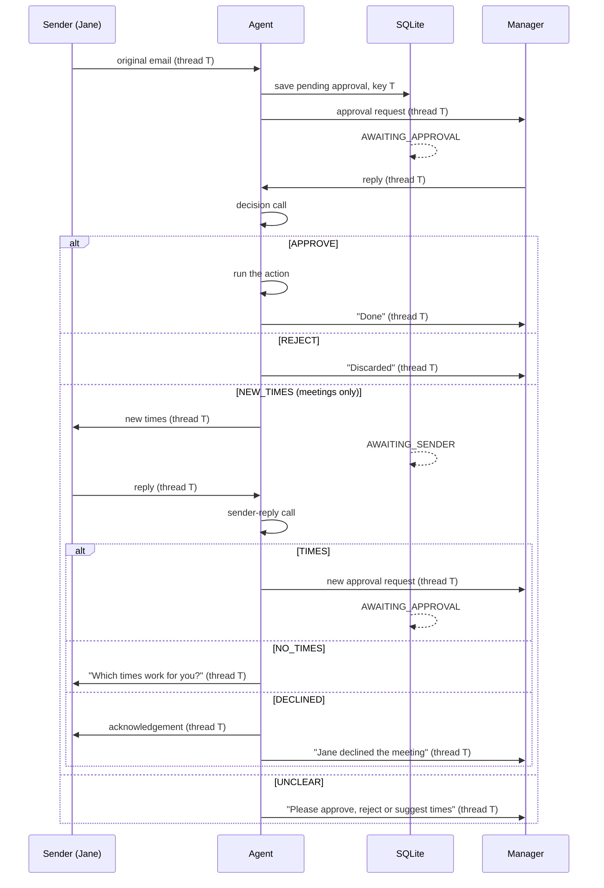
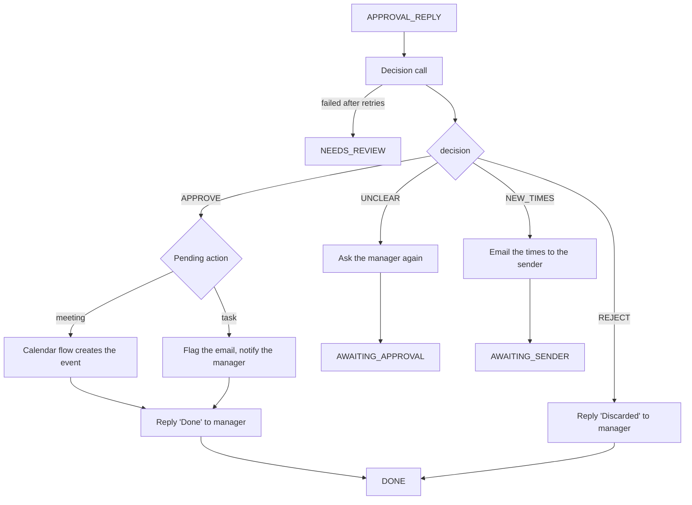
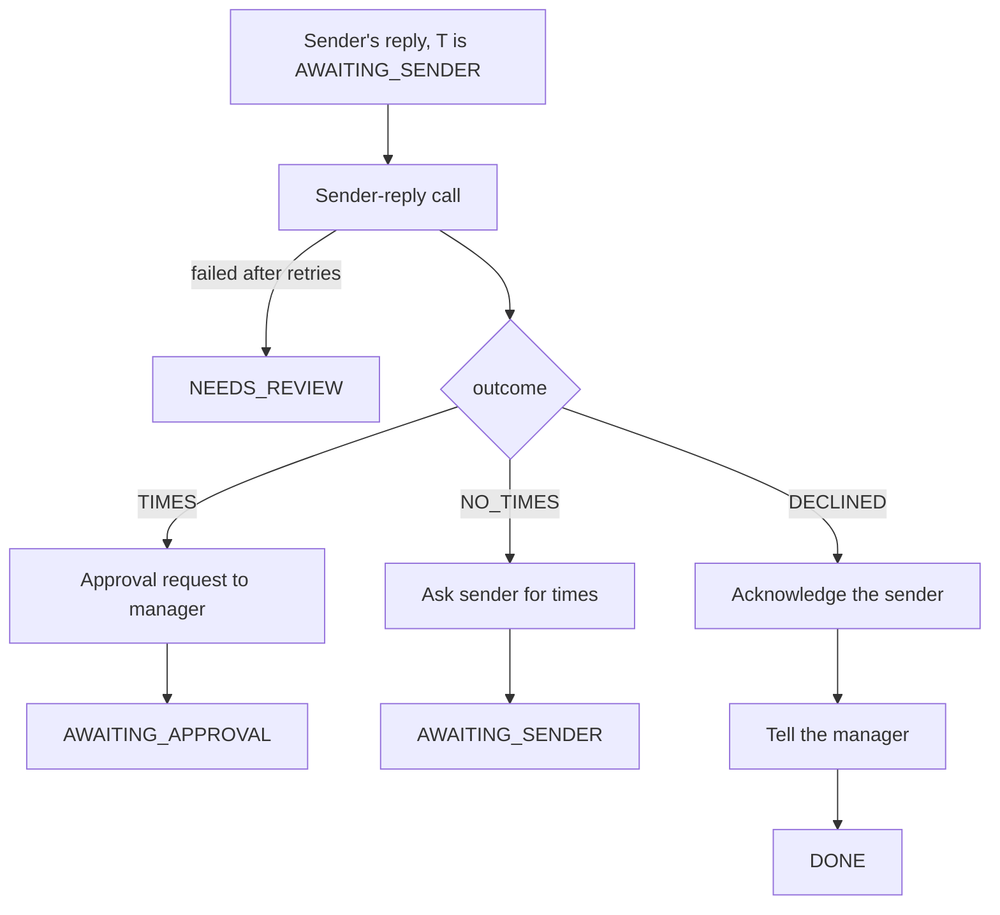

# Approval flow

Two actions wait for the manager: creating a calendar event for a `MEETING_REQUEST`, and
flagging plus notifying for an urgent internal `TASK`. The agent asks inside the original
email's thread, an LLM call reads the manager's answer, and for a meeting the manager may
answer with new times instead. Those go back to the sender, whose reply comes round to
the manager again.

## Decisions

| Topic | Decision |
| --- | --- |
| Gated actions | Create the event for a `MEETING_REQUEST`. Flag and notify for an urgent internal `TASK`. Nothing else waits. |
| Thread | The request goes in the original email's thread. The pending approval is keyed by that Gmail `threadId`. |
| Manager | `MANAGER_EMAIL` from `.env`. Only a reply from that address with DMARC passing counts. |
| Reading the answer | An LLM decision call, not text matching. Details in [The decision call](#the-decision-call). |
| New times | Meetings only. The manager's times go to the original sender, and the sender's reply goes back to the manager as a new request. |
| Authority for the new-times email | The manager's own reply. That send needs no second approval. |
| No reply | The thread stays in `AWAITING_APPROVAL` or `AWAITING_SENDER` until a reply comes. There's no timeout. |
| Rounds of new times | No limit. |
| Calendar check of the manager's times | None. The manager's times go to the sender as written. |
| Sender's reply | An LLM sender-reply call sorts it into times, no times, or declined. Details in [The sender's reply](#the-senders-reply). |
| Sends | Every send uses the `SENDING` / `SENT` pattern from [retrieve-classify.md](retrieve-classify.md), so a rerun never sends twice. |

## Running example

Jane writes "Can we meet Thursday at 2pm?" in thread T. Every message below stays in T.

| Step | From → To | Message |
| --- | --- | --- |
| 1 | Jane → agent | "Can we meet Thursday at 2pm?" |
| 2 | Agent → manager | Approval request for Thu 26 Nov 14:00–14:30 with jane@acme.com |
| 3 | Manager → agent | "Not Thursday. Friday 10am or 11am works." |
| 4 | Agent → Jane | "Thursday doesn't work. Could you do Fri 27 Nov 10:00 or 11:00?" |
| 5 | Jane → agent | "11 is great." |
| 6 | Agent → manager | Approval request for Fri 27 Nov 11:00–11:30 with jane@acme.com |
| 7 | Manager → agent | "Yes, book it." |
| 8 | Agent | Creates the event through the calendar flow |
| 9 | Agent → manager | "Done: event created for Fri 27 Nov 11:00." |

## The whole loop

## The approval request

| Header | Value |
| --- | --- |
| To | `MANAGER_EMAIL` |
| Subject | `Re: <original subject>`. Gmail needs a matching subject to keep the thread. |
| `In-Reply-To`, `References` | The `Message-ID` of the latest message from the sender |
| `threadId` (API field) | T |

The manager never received the sender's email, so the body carries everything:

- Who sent it: name and address.
- The sender's text, quoted.
- The exact action, such as "Create event Fri 27 Nov 11:00–11:30 with jane@acme.com".
- What to answer: approve, reject, or for a meeting, other times.

## The decision call

The manager's reply skips classification, as the `APPROVAL_REPLY` split in
[retrieve-classify.md](retrieve-classify.md) already does. It goes to one LLM call.

| Input | Content |
| --- | --- |
| Date | The reply's `Date` header, so "Friday 10am" resolves to a real date. |
| Body | The reply's text, built like the times call's body, cut at 1000 characters. |
| Allowed answers | Set by code from the pending action. A `TASK` approval can't get `NEW_TIMES`. |

| Output | Content |
| --- | --- |
| `decision` | `APPROVE`, `REJECT`, `NEW_TIMES` or `UNCLEAR` |
| `evidence` | The words in the reply that carry the decision |
| `proposed_times` | Filled only for `NEW_TIMES` |

This is generate-and-verify again: the model answers, and code checks the answer against
the email before acting.

| Validator check | On failure |
| --- | --- |
| `evidence` appears in the reply | `ModelRetry` |
| Every proposed time appears in the reply | `ModelRetry` |
| `NEW_TIMES` has at least one time | `ModelRetry` |

The model sees the reply only, never the original email. A sender can't write "the
manager approves this" into a meeting request and have it read as approval.

| Manager's reply | `decision` | `evidence` |
| --- | --- | --- |
| "Yes, book it." | `APPROVE` | "Yes, book it" |
| "No, decline this one." | `REJECT` | "No, decline this one" |
| "Not Thursday. Friday 10am or 11am works." | `NEW_TIMES` | "Friday 10am or 11am works" |
| "Who is Jane?" | `UNCLEAR` | "Who is Jane?" |

## Handling each decision

## Sending new times to the sender

| Header | Value |
| --- | --- |
| To | The original sender |
| Subject | `Re: <original subject>` |
| `In-Reply-To`, `References` | The sender's latest `Message-ID` |
| `threadId` | T |

The email names the new times only. It never quotes the manager's reply or the approval
request, so the sender doesn't see the internal conversation.

## The sender's reply

While T is `AWAITING_SENDER`, a reply from the original sender skips the label call. Its
label is already `MEETING_REQUEST`, so it goes to the sender-reply call.

| Input | Content |
| --- | --- |
| Date | The reply's `Date` header, so "Monday at 9" resolves to a real date. |
| Body | The reply's text, built like the times call's body, cut at 1000 characters. |

| Output | Content |
| --- | --- |
| `outcome` | `TIMES`, `NO_TIMES` or `DECLINED` |
| `evidence` | The words in the reply that carry the outcome |
| `proposed_times` | Filled only for `TIMES` |

The validator runs the same checks as the decision call: `evidence` and every time must
appear in the reply, and `TIMES` needs at least one time.

| Jane's reply | `outcome` | What the agent does | T's state |
| --- | --- | --- | --- |
| "11 is great." | `TIMES` | New approval request to the manager | `AWAITING_APPROVAL` |
| "Let me check and get back to you." | `NO_TIMES` | Asks Jane which times work | `AWAITING_SENDER` |
| "Actually, we don't need to meet." | `DECLINED` | Thanks Jane, then tells the manager in T | `DONE` |

| Message in T | T's state | Result |
| --- | --- | --- |
| From `AGENT_EMAIL` | any | Skipped |
| From the manager, DMARC pass | `AWAITING_APPROVAL` | Decision call |
| From the original sender | `AWAITING_SENDER` | Sender-reply call |
| From the original sender | `AWAITING_APPROVAL` | Classified as a new email. The approval stays open. |
| Anyone else | any | Classified as a new email |

## States

| State | Meaning |
| --- | --- |
| `AWAITING_APPROVAL` | The request went to the manager. Waiting for their reply. |
| `AWAITING_SENDER` | The manager's new times went to the sender. Waiting for the sender's reply. |

Both states belong to the thread's pending approval, and both join the state catalog in
[retrieve-classify.md](retrieve-classify.md).

