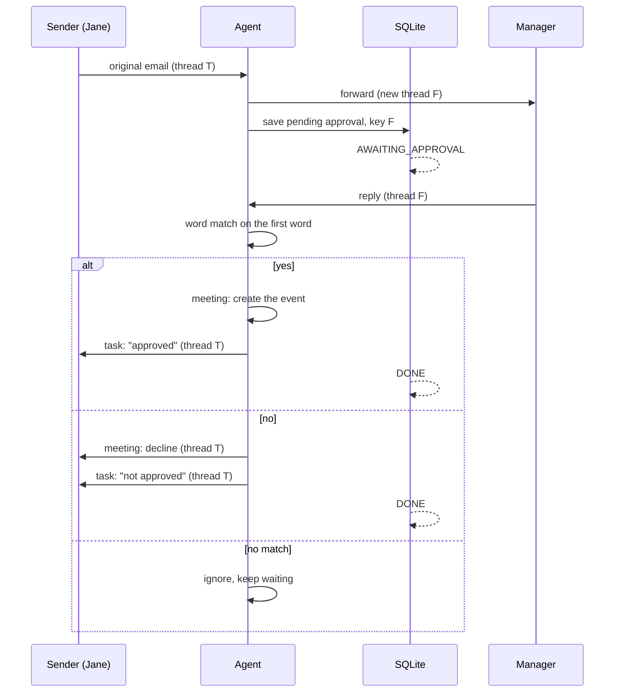
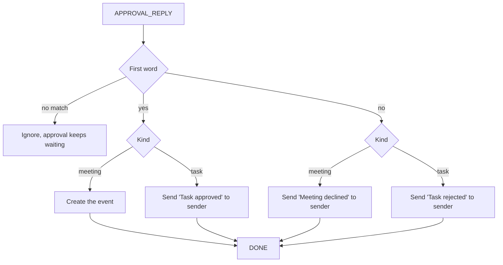

# Approval flow

Two kinds of email wait for the manager: a `MEETING_REQUEST` with a date, and every
`TASK`. The agent forwards the email to the manager, the manager replies yes or no, and
code reads the first word of the reply. Then the agent books the meeting, or tells the
sender the answer.

## Decisions

| Topic | Decision |
| --- | --- |
| Gated emails | A `MEETING_REQUEST` whose times call found a date, and every `TASK`, internal or external, urgent or not. Nothing else waits. |
| Beyond the requirements | The requirements table gates only urgent internal tasks. This project gates every `TASK`. |
| What a `TASK` is | A request the manager can approve or reject. See [classify-tree.md](classify-tree.md#what-each-label-means). |
| Meeting without a date | Not gated. The sender is asked for a date and time, as in [classify-tree.md](classify-tree.md#step-order). |
| Urgent | The `URGENT` label goes on with the email's label, before the forward. The forward's subject and first line say it's urgent. |
| The forward | A new email to `MANAGER_EMAIL` that quotes the original. Its subject differs from the original, so Gmail starts a new thread, F. |
| Pending approval | One row per forward, keyed by F's `threadId`. It points back to the original email and its thread, T. |
| Manager | `MANAGER_EMAIL` from `.env`. Only a reply from that address with DMARC passing counts. |
| Reading the answer | The first word of the reply, ignoring case and trailing punctuation. No LLM call. Details in [The word match](#the-word-match). |
| Unmatched reply | Ignored. The approval keeps waiting. |
| No reply | The approval stays `AWAITING_APPROVAL` until a matching reply comes. There's no timeout. |
| Calendar check | None in v1. The meeting is booked at the extracted date and time. |
| Sends | Every send uses the `SENDING` / `SENT` pattern from [retrieve-classify.md](retrieve-classify.md#sending-without-duplicates), so a rerun never sends twice. |

## Running example

Jane (jane@acme.com) writes two emails on Mon 23 Nov 2026.

| Step | From → To | Thread | Message |
| --- | --- | --- | --- |
| 1 | Jane → agent | T1 | "Need approval for PTO tomorrow" |
| 2 | Agent → manager | F1 | "Approval needed: PTO tomorrow", quoting Jane |
| 3 | Manager → agent | F1 | "Yes, enjoy" |
| 4 | Agent → Jane | T1 | "Hi Jane, your request was approved." |
| 5 | Jane → agent | T2 | "Can we meet Thu 26 Nov 2026?" |
| 6 | Agent → manager | F2 | "Meeting request: Quick sync", for Thu 26 Nov 10:00–10:30 |
| 7 | Manager → agent | F2 | "Approved" |
| 8 | Agent | | Creates the event, Jane invited. Google emails her the invite. |

## The whole loop

## The forward

| Header | Value |
| --- | --- |
| To | `MANAGER_EMAIL` |
| Subject | From the template: `Approval needed: <original subject>` for a task, `Meeting request: <original subject>` for a meeting. Urgent versions start with `Urgent`. |
| `In-Reply-To`, `References` | None. The forward starts its own thread. |

The manager never received the sender's email, so the body carries everything: the first
line from the template, then who sent it and their text, quoted. The templates are in
[email-templates.md](email-templates.md).

Gmail returns the forward's `threadId` when it's sent. That's F, and the pending approval
is saved under it. A second gated email in T just gets its own forward and its own F.

## The word match

The manager's reply skips classification, as the `APPROVAL_REPLY` split in
[retrieve-classify.md](retrieve-classify.md#one-email) already does. Code takes the first
word of the reply's newest text, lowercases it, and strips trailing punctuation.

| First word | Answer |
| --- | --- |
| `yes`, `approve`, `approved` | Yes |
| `no`, `reject`, `rejected` | No |
| Anything else | No match |

| Manager's reply | Answer |
| --- | --- |
| "Yes, enjoy" | Yes |
| "APPROVED." | Yes |
| "No - not this week" | No |
| "Who is Jane?" | No match, ignored |
| "Sure, go ahead" | No match, ignored |

The word lists are fixed in code, in [config.md](config.md#fixed-in-code).

## Handling each answer

| Kind | Yes | No |
| --- | --- | --- |
| `MEETING` | Create the event through the [calendar flow](calendar-scheduling.md). Google emails the sender the invite. | Send the sender "Meeting declined" in T. |
| `TASK` | Send the sender "Task approved" in T. | Send the sender "Task rejected" in T. |

Both close the approval as `DONE`, and the original email moves to `DONE`. A no-match
reply changes nothing: the approval and the original email stay `AWAITING_APPROVAL`.

## Messages in the forward's thread

| Message in F | Approval state | Result |
| --- | --- | --- |
| From `AGENT_EMAIL` | any | Skipped |
| From the manager, DMARC pass | `AWAITING_APPROVAL` | `APPROVAL_REPLY`, word match |
| From the manager | `DONE` | Classified as a new email |
| Anyone else | any | Classified as a new email |

## States

| State | Meaning |
| --- | --- |
| `AWAITING_APPROVAL` | The forward went to the manager. Waiting for a matching reply. |

It belongs to the pending approval and to the original email, and it's in the
[state catalog](state-audit.md#state-catalog). So is the reply state `APPROVAL_REPLY`.
