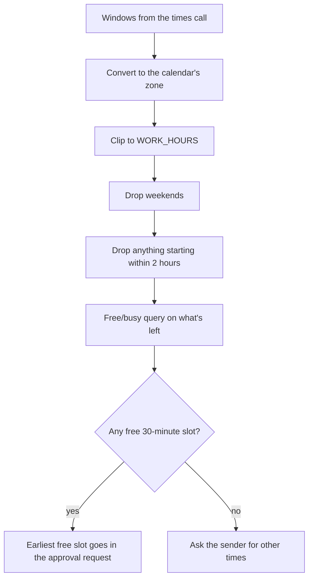

# Calendar scheduling

How the agent turns a meeting request into a slot on its own calendar, and how it creates
the event. When the calendar gets checked, and who approves, is in
[approval.md](approval.md#checking-the-calendar).

## Decisions

| Topic | Decision |
| --- | --- |
| Calendar | The agent account's own Google Calendar, the one the brief pre-populates. No other calendar is read or written, and no extra token is needed. |
| Accounts | `MANAGER_EMAIL` and `AGENT_EMAIL` are different accounts. |
| Length | 30 minutes when the email gives none. |
| Vague times | "Thursday afternoon" is a window. The agent books the earliest free slot inside it. |
| Time zone | The sender's. Taken from the `Date` header offset, unless the email names a zone. |
| Work hours | `WORK_HOURS=09:00-17:00` in `.env`, read in the calendar's own time zone. |
| Notice | A slot must start at least 2 hours from now. |
| Weekends | Never booked. |
| No times in the email | The agent picks 3 free slots and asks the manager to approve offering them. |
| Event | Title from the subject, a link to the thread in the description, the sender invited, Google emails the invite. |
| Rerun guard | A fixed event ID. A second insert returns `409`, which counts as done. |

## Running example

Jane, in UTC+2, writes on Mon 23 Nov. The agent calendar runs in UTC.

| Jane writes | Window in UTC | Calendar | Slot offered to the manager |
| --- | --- | --- | --- |
| "Thursday at 2pm" | Thu 26 Nov 12:00–12:30 | Free | Thu 12:00–12:30 |
| "Thursday afternoon" | Thu 26 Nov 10:00–15:00 | Busy 10:00–13:00 | Thu 13:00–13:30 |
| "Saturday at 10" | Sat 28 Nov 08:00–08:30 | Free | None: weekend. Jane is asked for other times. |
| "Can we meet next week?" | No window | — | Three free slots, offered to the manager for approval |

## Times as windows

The times call returns every proposed time as a window. A clock time becomes a 30-minute
window, and a part of the day becomes a wider one.

| Field | Holds |
| --- | --- |
| `quote` | The words in the email, such as "Thursday afternoon". The validator checks they appear in the email. |
| `start`, `end` | The window, with the sender's UTC offset. |

| Email says | `start` | `end` |
| --- | --- | --- |
| "Thu 2pm" | Thu 14:00 | Thu 14:30 |
| "Thu 2–4pm" | Thu 14:00 | Thu 16:00 |
| "Thursday afternoon" | Thu 12:00 | Thu 17:00 |

The model resolves dates against the `Date` header, as it already does in
[retrieve-classify.md](retrieve-classify.md#what-the-times-call-sees). Code converts each
window to the calendar's time zone, which it reads from the calendar's settings.

## Picking a slot

Code applies the rules in order. The model plays no part here.

| Rule | Window before | Window after |
| --- | --- | --- |
| Clip to work hours | Thu 07:00–10:00 | Thu 09:00–10:00 |
| Drop weekends | Sat 10:00–10:30 | Nothing |
| 2 hours' notice, now is Thu 11:00 | Thu 12:00–14:00 | Thu 13:00–14:00 |

A window that ends up empty is dropped. When every window is dropped, the agent asks the
sender for other times, as in [approval.md](approval.md#checking-the-calendar).

## No times in the email

"Can we meet next week?" has no window at all. The agent offers slots of its own.

1. Code searches forward from now for the first 3 free 30-minute slots that pass every
   rule above, on different days where possible.
2. The approval request asks the manager to approve offering those slots to the sender.
3. `APPROVE` sends the slots to the sender, and T becomes `AWAITING_SENDER`.
4. The sender's pick comes back through the sender-reply call, then through the usual
   calendar check and approval request.

`REJECT` and `NEW_TIMES` work as in [approval.md](approval.md#handling-each-decision).

## The event

| Field | Value |
| --- | --- |
| `id` | `<threadId>r<round>`, such as `18c2f0a1b2c3d4e5r2` |
| `summary` | The original subject, without `Re:` |
| `description` | A link to thread T in the agent's Gmail |
| `start`, `end` | The approved slot, in the calendar's zone |
| `attendees` | The original sender |
| `sendUpdates` | `all`, so Google emails the sender the invite |

`round` counts the approval requests sent in T, starting at 1. A rerun builds the same
ID, so the second insert returns `409 Conflict` and the agent treats the event as created.

The `threadId` is hex, and the letter `r` is valid in Google's base32hex ID alphabet, so
the ID always passes Google's format check.

| Case | Insert result | Agent does |
| --- | --- | --- |
| First run | `200` | Replies "Done" to the manager |
| Crash after the insert, then a rerun | `409` | Replies "Done" to the manager |
| A later round in the same thread | `200`, new ID | Creates the new event |
