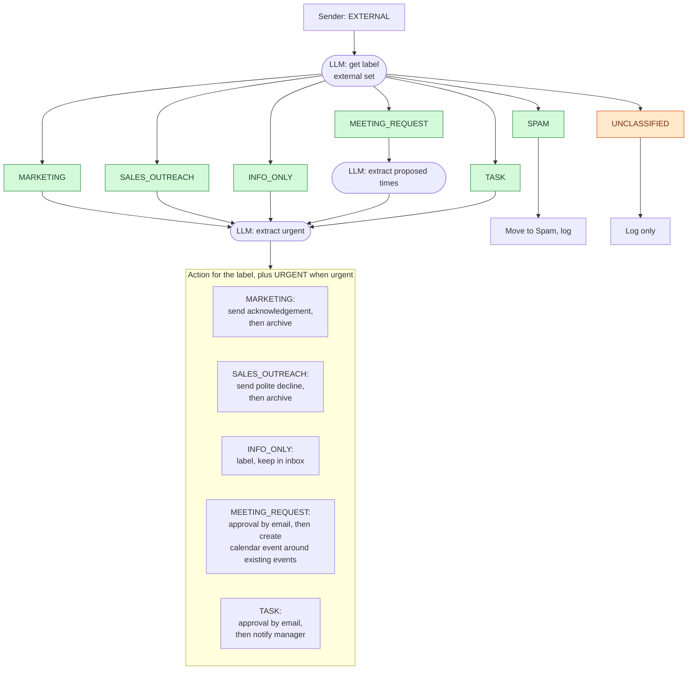
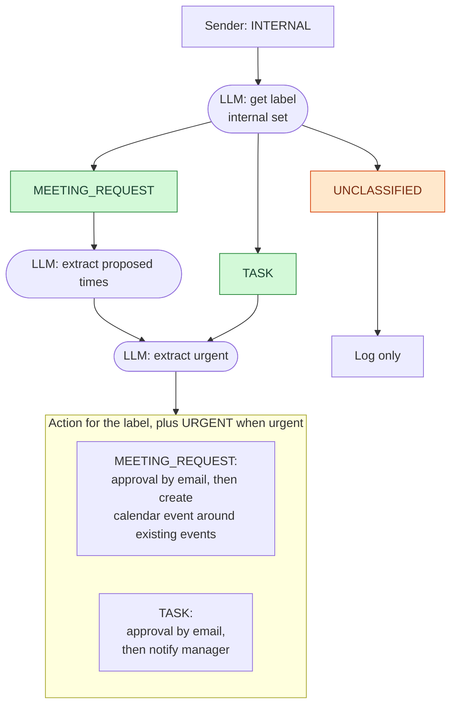

# Classification tree

Code checks the sender first, with the allowlist plus DMARC. The result picks one of the
two trees below.

Rounded boxes are LLM calls. The mapper is plain code. Green boxes are labels. The orange
box is `UNCLASSIFIED`, the escape hatch.

Every label except `SPAM` and `UNCLASSIFIED` runs the urgent call, because `URGENT` is a
modifier the requirements allow on any other label. The mapper then runs the label's
action and adds `URGENT` when the call found a deadline or an escalation.

## External sender

| Email | LLM calls | Action |
| --- | --- | --- |
| Newsletter | label, urgent | Send acknowledgement, then archive |
| Cold pitch | label, urgent | Send polite decline, then archive |
| Phishing link | label | Move to Spam, log |
| FYI from a partner | label, urgent | Label, keep in inbox |
| Meeting invite from a vendor | label, times, urgent | Approval, then create event |
| Task from a customer | label, urgent | Approval, then notify manager |
| Email that fits no label | label | Log only |

## Internal sender

| Email | LLM calls | Action |
| --- | --- | --- |
| CEO: "contract due today" | label, urgent | Approval, then add `URGENT` and notify manager |
| Colleague proposes Thu 2pm | label, times, urgent | Approval, then create event |
| Colleague shares a newsletter | label | Log only |

## What each label does in Gmail

An email is archived only when [REQUIREMENTS.md](REQUIREMENTS.md#required-behaviour) says
so. Every other email keeps its label and stays in the inbox.

| Label | Gmail result |
| --- | --- |
| `MARKETING` | `MARKETING` label, archived after the acknowledgement is sent. |
| `SALES_OUTREACH` | `SALES_OUTREACH` label, archived after the decline is sent. `SEND_SALES_DECLINE=false` in `.env` skips the decline. |
| `INFO_ONLY`, invoice | `INFO_ONLY` and `Finance` labels, archived. The finance check in [retrieve-classify.md](retrieve-classify.md#one-email) sets it before the tree runs. |
| `INFO_ONLY`, anything else | `INFO_ONLY` label, stays in the inbox. |
| `SPAM` | Moved to Spam. |
| `MEETING_REQUEST` | `MEETING_REQUEST` label, stays in the inbox. |
| `TASK` | `TASK` label, stays in the inbox. |
| `UNCLASSIFIED` | No label, stays in the inbox. |

`URGENT` is added with the label's action whenever the urgent call returns `urgent: true`.
"Flag" means adding `URGENT`. A `TASK` gets it after the manager approves, and the other
labels get it right away. An invoice never reaches an LLM call, so it never gets `URGENT`.
