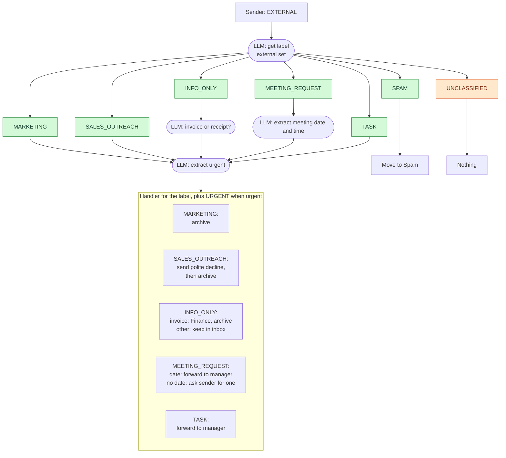
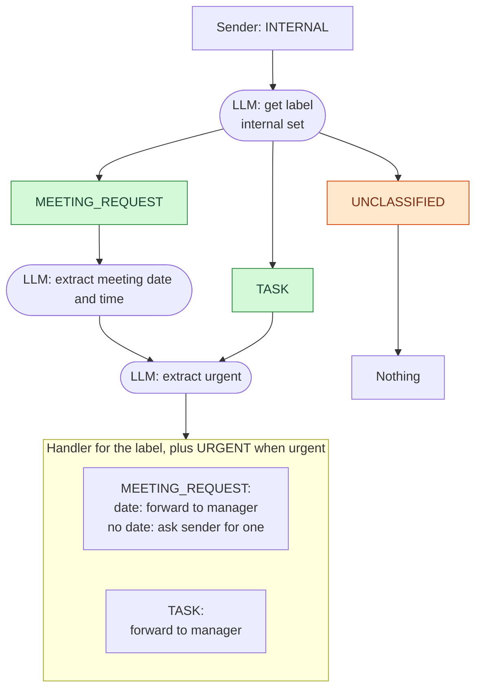

# Classification tree

Code checks the sender first, with the allowlist plus DMARC. The result picks one of the
two trees below. Each tree ends in a handler, one per (sender, label) pair.

Rounded boxes are LLM calls. Handlers are plain code. Green boxes are labels. The orange
box is `UNCLASSIFIED`, the escape hatch.

Every label except `SPAM` and `UNCLASSIFIED` runs the urgent call, because `URGENT` is a
modifier the requirements allow on any other label. The urgent flag is a parameter of the
handler. Every handler except `SPAM`'s adds the `URGENT` label when the flag is set.

This is *routing with per-route extraction*. One call routes the email to a label, then
smaller calls pull out only the fields that label's handler needs.

| Label | Extraction calls | Context the handler gets |
| --- | --- | --- |
| `MARKETING` | urgent | `urgent` |
| `SALES_OUTREACH` | urgent | `urgent` |
| `INFO_ONLY` | urgent, invoice | `urgent`, `is_invoice` |
| `MEETING_REQUEST` | times, urgent | `urgent`, `meeting_date`, `meeting_time` |
| `TASK` | urgent | `urgent` |
| `SPAM` | none | nothing |
| `UNCLASSIFIED` | none | nothing |

## What each label means

| Label | Means | Example |
| --- | --- | --- |
| `TASK` | A request the manager can approve or reject. | "Need approval for PTO tomorrow" |
| `UNCLASSIFIED` | Fits no other label, including action items that can't be approved. | "Need that velocity report" |

The other labels keep their meaning from [REQUIREMENTS.md](REQUIREMENTS.md#labels).

## External sender

| Email | LLM calls | Handler does |
| --- | --- | --- |
| Newsletter | label, urgent | Archive |
| Cold pitch | label, urgent | Send polite decline, then archive |
| Phishing link | label | Move to Spam |
| Invoice from a vendor | label, invoice, urgent | Add `Finance`, archive |
| FYI from a partner | label, invoice, urgent | Keep in inbox |
| "Can we meet Thu 26 Nov at 14:00?" | label, times, urgent | Forward to the manager for a yes or no |
| "Can we meet next week?" | label, times, urgent | Ask the sender for a date and time |
| "Please approve our revised quote" | label, urgent | Forward to the manager for a yes or no |
| Email that fits no label | label | Nothing |

## Internal sender

| Email | LLM calls | Handler does |
| --- | --- | --- |
| Colleague: "Need approval for PTO tomorrow, urgent" | label, urgent | `URGENT` added, forward to the manager |
| Colleague: "Meet Thu 26 Nov?" | label, times, urgent | Forward to the manager |
| Colleague: "Need that velocity report" | label | Nothing |
| Colleague shares a newsletter | label | Nothing |

## Handlers

One handler per (sender, label) pair. Internal senders only get three labels, and their
`MEETING_REQUEST` and `TASK` handlers are the external ones.

| Sender | Label | Handler |
| --- | --- | --- |
| External | `MARKETING` | Tag, archive |
| External | `SALES_OUTREACH` | Tag, send the sales decline, archive |
| External | `INFO_ONLY` | Tag. When `is_invoice`, add `Finance` and archive |
| External | `SPAM` | Move to Spam |
| External | `MEETING_REQUEST` | Tag. With a date, forward to the manager. Without one, ask the sender for a date and time |
| External | `TASK` | Tag, forward to the manager |
| External | `UNCLASSIFIED` | Nothing |
| Internal | `MEETING_REQUEST` | The external `MEETING_REQUEST` handler |
| Internal | `TASK` | The external `TASK` handler |
| Internal | `UNCLASSIFIED` | Nothing |

"Tag" means adding the label's own Gmail label, plus `URGENT` when the flag is set. What
happens after the manager's yes or no is in [approval.md](approval.md).

## What each label does in Gmail

| Label | Gmail result |
| --- | --- |
| `MARKETING` | `MARKETING` label, archived. |
| `SALES_OUTREACH` | `SALES_OUTREACH` label, archived after the decline is sent. `SEND_SALES_DECLINE=false` in `.env` skips the decline. |
| `INFO_ONLY`, invoice or receipt | `INFO_ONLY` and `Finance` labels, archived. |
| `INFO_ONLY`, anything else | `INFO_ONLY` label, stays in the inbox. |
| `SPAM` | Gmail's built-in `SPAM` label, which moves it to the Spam folder. |
| `MEETING_REQUEST` | `MEETING_REQUEST` label, stays in the inbox. |
| `TASK` | `TASK` label, stays in the inbox. |
| `UNCLASSIFIED` | No label, stays in the inbox. |

`URGENT` goes on together with the email's label whenever the urgent call returns
`urgent: true`, before any approval. `SPAM` and `UNCLASSIFIED` skip the urgent call, so
they never get `URGENT`.

## Dev mode

With `RUN_MODE=dev`, nothing leaves the inbox and nothing is booked. Labels are added as
in prod. Forwards to `MANAGER_EMAIL` are really sent, so the approval flow can be tested.
Every other send and every booking is printed as `DEV would send <template> to <address>`
or `DEV would book <start>-<end> <title>`.

| Label | Prod Gmail result | Dev Gmail result |
| --- | --- | --- |
| `MARKETING` | `MARKETING`, archived | `MARKETING`, `This is archived` |
| `SALES_OUTREACH` | `SALES_OUTREACH`, decline sent, archived | `SALES_OUTREACH`, `This is archived`, decline printed |
| `INFO_ONLY`, invoice | `INFO_ONLY`, `Finance`, archived | `INFO_ONLY`, `Finance`, `This is archived` |
| `SPAM` | Moved to Spam | `This is spam`, stays in the inbox |
| `MEETING_REQUEST`, `TASK` | Label, forward or date request sent | Label, the send printed |

Each dev start removes every agent label from emails past `NEW`, including `URGENT`,
`Finance` and the two dev labels, and puts their rows back to `NEW`. The same inbox is
then processed again. A dev full sync picks up read inbox mail too, so opening a sample
in Gmail doesn't hide it.

## Step order

Code runs each handler's steps in a fixed order: labels first, then sends, then archive.
Labels are safe to repeat, and every send is guarded by the `sends` table. Archiving comes
last, so a crash leaves the email visible in the inbox.

| Label | Steps, in order | State reached |
| --- | --- | --- |
| `MARKETING` | Add `MARKETING` (+ `URGENT`). Remove `INBOX`. | `ARCHIVED`, then `DONE` |
| `SALES_OUTREACH` | Add `SALES_OUTREACH` (+ `URGENT`). Send the decline unless `SEND_SALES_DECLINE=false`. Remove `INBOX`. | `ARCHIVED`, then `DONE` |
| `INFO_ONLY`, invoice | Add `INFO_ONLY`, `Finance` (+ `URGENT`). Remove `INBOX`. | `ARCHIVED`, then `DONE` |
| `INFO_ONLY`, other | Add `INFO_ONLY` (+ `URGENT`). | `DONE` |
| `SPAM` | Add `SPAM` and remove `INBOX`, which moves it to Spam. | `DONE` |
| `MEETING_REQUEST`, date | Add `MEETING_REQUEST` (+ `URGENT`). Send the meeting forward to the manager. | `AWAITING_APPROVAL` |
| `MEETING_REQUEST`, no date | Add `MEETING_REQUEST` (+ `URGENT`). Send the sender "Ask for a date and time". | `DONE` |
| `TASK` | Add `TASK` (+ `URGENT`). Send the task forward to the manager. | `AWAITING_APPROVAL` |
| `UNCLASSIFIED` | Nothing. | `DONE` |

The sender's answer to "Ask for a date and time" is a new email in the same thread. It's
classified like any other email, so a reply with a date becomes a `MEETING_REQUEST` and
gets forwarded.
