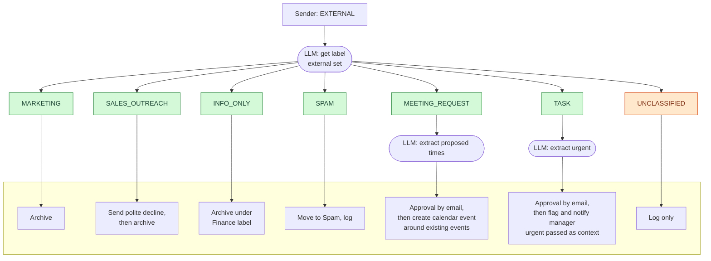
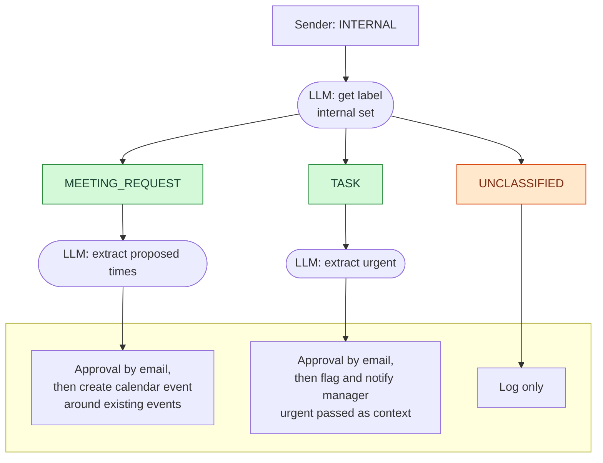

# Classification tree

Code checks the sender first, with the allowlist plus DMARC. The result picks one of the
two trees below.

Rounded boxes are LLM calls. The mapper is plain code. Green boxes are labels. The orange
box is `UNCLASSIFIED`, the escape hatch.

## External sender

| Email | LLM calls | Action |
| --- | --- | --- |
| Newsletter | label | Archive |
| Cold pitch | label | Send polite decline, then archive |
| Phishing link | label | Move to Spam, log |
| Receipt from a supplier | label | Archive under Finance label |
| Meeting invite from a vendor | label, times | Approval, then create event |
| Task from a customer | label, urgent | Approval, then flag and notify manager |
| Email that fits no label | label | Log only |

## Internal sender

| Email | LLM calls | Action |
| --- | --- | --- |
| CEO: "contract due today" | label, urgent | Approval, then flag and notify manager |
| Colleague proposes Thu 2pm | label, times | Approval, then create event |
| Colleague shares a newsletter | label | Log only |
