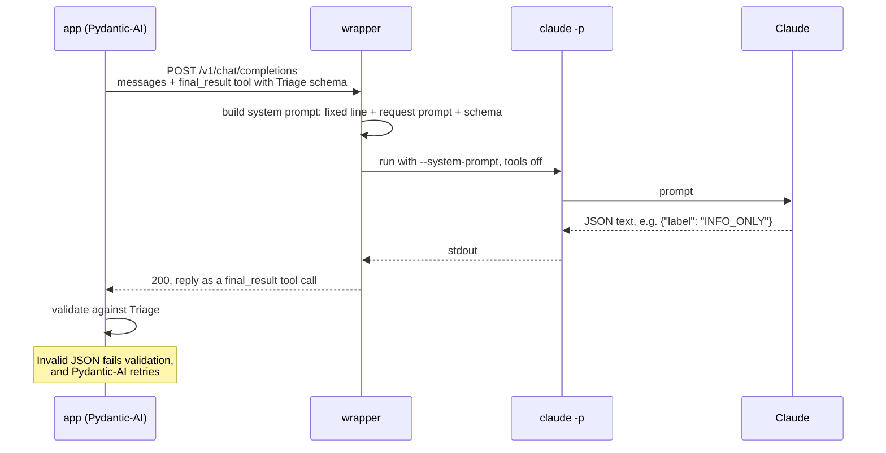
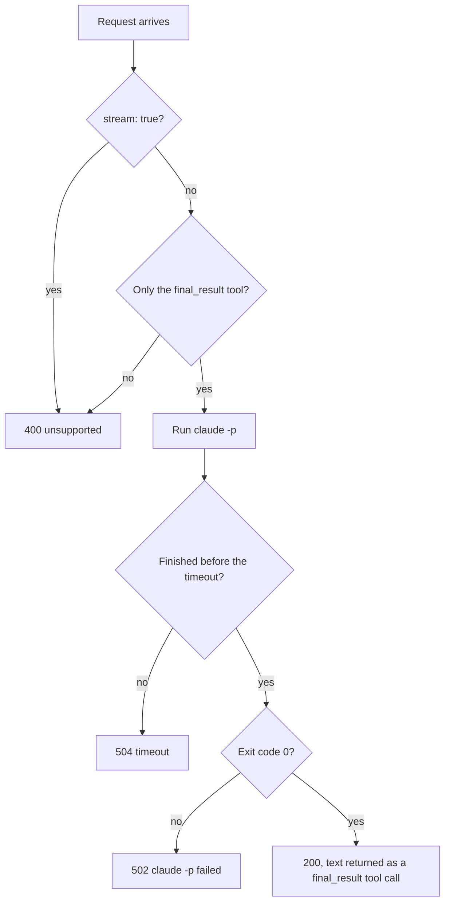

# Development wrapper over `claude -p`

In development the classifier calls Claude through a Claude subscription instead of the
Anthropic API. The `wrapper` service exposes an OpenAI-style endpoint that runs
`claude -p` for each request. `app` talks to it through Pydantic-AI's OpenAI provider, so
the app code is the same in development and production. How both services are wired is
in [containers.md](containers.md).

## Decisions

| Topic | Decision |
| --- | --- |
| When it runs | Only under the compose `dev` profile. |
| Language | Python, on the same uv base image as `app`. |
| Server | FastAPI on uvicorn, port 8000. Both live in the `wrapper` dependency group of the shared uv project. |
| Claude Code | Installed with the native installer at a pinned version. No Node. |
| Login | A `claude setup-token` token in `./secrets/claude_token`, passed as `CLAUDE_CODE_OAUTH_TOKEN`. |
| Endpoint | `POST /v1/chat/completions`, non-streaming, with a `final_result` tool only. |
| Reachability | No published ports. Only `app` reaches it, at `http://wrapper:8000`. |
| User | Non-root. |
| Claude Code tools | Turned off. The model can only answer with text. |
| System prompt | A short fixed line plus the request's own system prompt. Claude Code's default prompt is never used. |

## Switching `app` to the wrapper

`.env` decides which model `app` calls:

| Environment | `LLM_MODEL` | `LLM_BASE_URL` | `llm_api_key` secret |
| --- | --- | --- | --- |
| Production | `anthropic:claude-sonnet-5-5` | empty, Anthropic's default | A real Anthropic key |
| Development | `openai:sonnet` | `http://wrapper:8000/v1` | Any dummy value. The wrapper ignores it. |

## Login

`claude setup-token` runs once on the host and prints a long-lived token. The token goes
into `./secrets/claude_token` and reaches only the `wrapper` container, at
`/run/secrets/claude_token`. The wrapper reads `$SECRETS_DIR/claude_token` once at startup,
with `/run/secrets` as the default, and stops with one line if the file is missing. On the
host, set `SECRETS_DIR=./secrets`. The wrapper sets `CLAUDE_CODE_OAUTH_TOKEN` for each
`claude -p` run only. The token doesn't refresh, so nothing is ever written back.

## System prompt

The wrapper passes `--system-prompt`, which replaces Claude Code's long default prompt. The
new prompt is kept minimal but not empty:

| Part | Content |
| --- | --- |
| Fixed line | "Reply with one JSON object that matches the schema below. No code fences, no other text." |
| Request's prompt | The system prompt Pydantic-AI sent, unchanged |
| Schema | The `final_result` tool's JSON schema |

The fixed line bans code fences because the wrapper never strips them, and a fenced reply
fails validation.

## The prompt and the run

`claude -p` takes one prompt text, so every non-system message is joined in order with a
role tag. On a retry Claude then sees its own bad answer and the validation error:

| Message | Prompt line |
| --- | --- |
| user: the email | `User: <email>` |
| assistant: `final_result` call | `Assistant: {"label": "FOO"}` |
| tool: the validation error | `Tool: <error>` |

The joined text goes in on stdin. The run's flags:

| Flag | Why |
| --- | --- |
| `--model <request model>` | `LLM_MODEL=openai:sonnet` runs `sonnet`. |
| `--system-prompt` | Replaces Claude Code's default prompt. |
| `--tools ""` | No tools. |
| `--setting-sources ""`, `--strict-mcp-config` | No user or project settings, hooks or MCP servers. |
| `--no-session-persistence` | Nothing saved per run. |

Each run's working folder is an empty temp folder, so no `CLAUDE.md` is found.

## One classify request

A *tool call* is a structured message where the model asks the caller to run a named
function. Pydantic-AI asks for its typed answer through a tool named `final_result`.
`claude -p` only returns text, so the wrapper turns that text into the tool call.

## Request handling

The wrapper doesn't check the JSON itself. A malformed reply still returns `200`, and
Pydantic-AI's validator rejects it and asks again.

| Case | Status |
| --- | --- |
| Non-streaming request with only `final_result` | `200` |
| `stream: true`, or any other tool | `400` |
| `claude -p` exits with an error | `502` |
| `claude -p` runs past the timeout | `504` |

## Lockdown

| Measure | Effect |
| --- | --- |
| No `ports:` entry | Nothing on the host or LAN can reach the wrapper. |
| Non-root user | A compromised process can't change the image's files. |
| Claude Code tools off | An email's text can't make Claude read files or run commands. |
| Only `claude_token` mounted | The wrapper never sees the Google tokens. |
