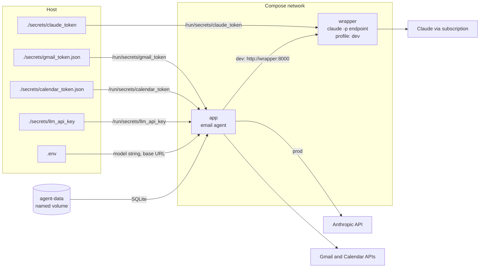
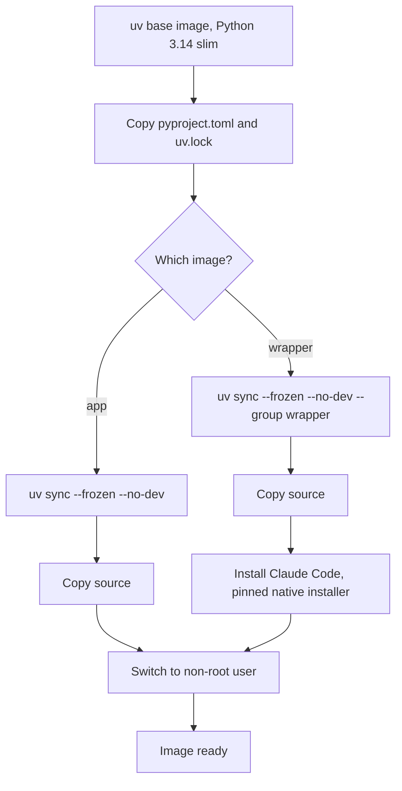

# Containers

The agent runs from one `compose.yaml`. The same file works with `podman compose` and
`docker compose`. The `app` service always runs. The `wrapper` service runs only in
development and is covered in [containers-dev.md](containers-dev.md).

## Decisions

| Topic | Decision |
| --- | --- |
| Orchestration | One `compose.yaml`, run with `podman compose` or `docker compose`. |
| Services | `app` is the email agent. `wrapper` is the `claude -p` endpoint, started only under the `dev` profile. |
| Secrets | Compose file secrets, read from `./secrets`. Each service gets only the files it needs. |
| Secret path | Each secret is mounted read-only at `/run/secrets/<name>`. |
| Images | Secrets are never `COPY`'d into an image, so no image layer holds a token. |
| State | SQLite lives in the `agent-data` named volume, mounted into `app` only. |
| Model switch | `.env` holds `LLM_MODEL` and `LLM_BASE_URL`. They point `app` at the Anthropic API or at the wrapper. |
| LLM key | The `llm_api_key` secret. Code reads the file and passes the key to the provider. In dev it holds a dummy value. |
| Config | Every `.env` variable is listed in [config.md](config.md). |
| Project layout | One uv project and one `uv.lock`. The wrapper's FastAPI and uvicorn sit in a `wrapper` dependency group, synced only into the wrapper image. |
| Base image | Astral's uv image on Python 3.14 slim, for both services. |
| User | Both containers run as a non-root user. |

Compose file secrets need no secret store. Docker supports `docker secret` only in Swarm
mode, but compose's `secrets: file:` works without Swarm. Under the hood it's a
read-only bind mount, so podman and docker behave the same.

## Services, secrets and volumes



| Service | Secrets | Volume | Ports published |
| --- | --- | --- | --- |
| `app` | `gmail_token`, `calendar_token`, `llm_api_key` | `agent-data` | none |
| `wrapper` | `claude_token` | none | none |

`app` never sees the Claude token, and `wrapper` never sees the Google tokens.

## Image build



`uv sync --frozen` fails when `uv.lock` doesn't match `pyproject.toml`. Every build then
installs the same package versions.

## Running

Production, with `app` calling the Anthropic API:

```powershell
podman compose up -d
```

```powershell
docker compose up -d
```

Development, with the wrapper started too. `.env` must point `app` at the wrapper:

```powershell
podman compose --profile dev up -d
```

```powershell
docker compose --profile dev up -d
```

## Inspecting state

The SQLite file lives inside the `agent-data` volume, not in the repo. Open a shell in
`app` to reach it:

```powershell
podman compose exec app sh
```

```powershell
docker compose exec app sh
```

Removing the volume resets every processed-email record and the saved `historyId`:

```powershell
podman compose down -v
```

```powershell
docker compose down -v
```
