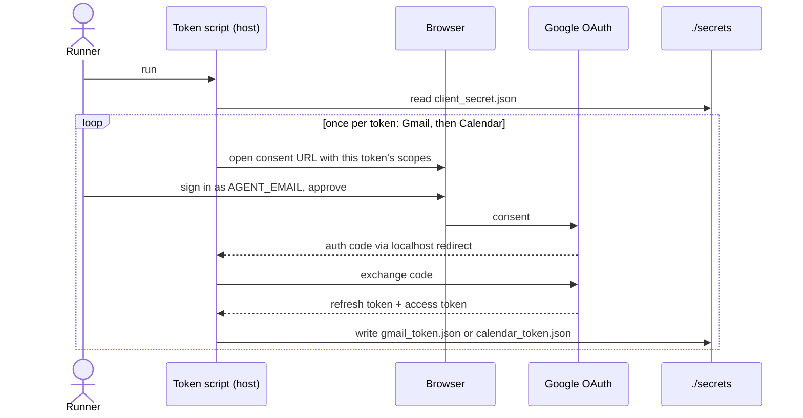
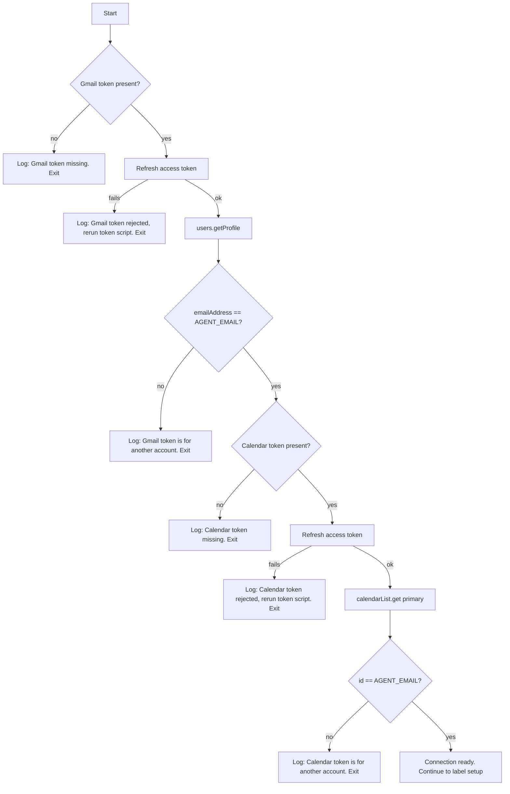
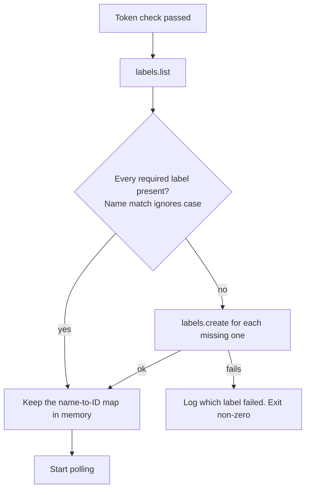

# Gmail and Calendar connection (OAuth)

The agent reaches Gmail and Google Calendar with two OAuth tokens. A host-side script
creates them as files in `./secrets`, and startup checks both before any email is
touched. How the files reach the container is covered in [containers.md](containers.md).

## Decisions

| Topic | Decision |
| --- | --- |
| Tokens | Two tokens. One holds Gmail scopes only, one holds Calendar scopes only. Each module loads only its own. |
| OAuth client | A "Desktop" client in Google Cloud Console. Whoever does the live run creates their own. |
| Consent screen | Stays in Testing mode. The agent's Gmail account is added as a test user. |
| Token lifetime | Testing mode expires refresh tokens after 7 days. That's accepted for a demo. |
| Consent step | A token script runs on the host, opens a browser, and writes the token files. |
| Storage | All secrets live in `./secrets`, which is gitignored. |
| Refresh | Access tokens refresh in memory. The token files are never written back. |
| Account check | Startup confirms both tokens belong to `AGENT_EMAIL` from `.env`. |
| Revoked or expired token | Fixed by hand: rerun the token script. |
| Label setup | A startup step after the token check. It creates missing labels and keeps each label's ID in memory. Details in [Label setup](#label-setup). |

## Scopes

| Token | Scope | Covers |
| --- | --- | --- |
| Gmail | `gmail.modify` | Read, label, archive, move to Spam, send, create labels, read the profile. |
| Calendar | `calendar.readonly` | The primary calendar's ID for the account check. |
| Calendar | `calendar.events` | Create events. |

`gmail.modify` can't permanently delete mail. The agent never needs to.

## Files

| File | Written by | Read by |
| --- | --- | --- |
| `./secrets/client_secret.json` | Downloaded from Cloud Console | Token script only |
| `./secrets/gmail_token.json` | Token script | Gmail module |
| `./secrets/calendar_token.json` | Token script | Calendar module |

Each token file holds the refresh token, `client_id` and `client_secret`. Only the token
script reads `client_secret.json`.

## Creating the tokens

The script runs the consent flow once per token. Each time, the runner signs in as the
agent's account and grants only that token's scopes.



## Startup check

Both tokens are checked before the agent reads any mail. A failed check logs which token
failed and why, then exits with a non-zero code. It prints no stack trace.



Matching ignores case.

## Label setup

Gmail's API applies labels by ID, such as `Label_42`, not by name. The agent needs every
label's ID before it acts on any email, so startup builds a name-to-ID map and creates
whatever is missing in the same pass.

| Label | Source |
| --- | --- |
| `MEETING_REQUEST`, `TASK`, `INFO_ONLY`, `SALES_OUTREACH`, `MARKETING`, `URGENT`, `Finance` | Created by the agent when missing. |
| `SPAM` | Gmail's built-in `SPAM` label. Never created. |



The step runs on every start and is safe to repeat. A label that already exists is reused,
including one the manager created by hand. The map lives only in memory, so a label renamed
in Gmail is picked up on the next restart.

## Replacing a token

When a token expires or is revoked, the agent can't recover on its own. Secrets are
refreshed by running the token script again, which overwrites both files in `./secrets`:

```powershell
uv run scripts/make_tokens.py
```
