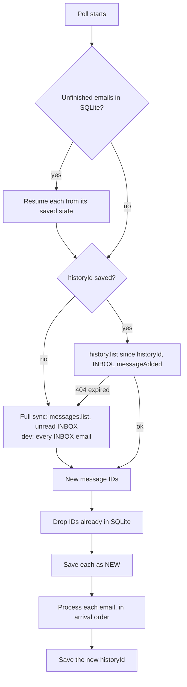
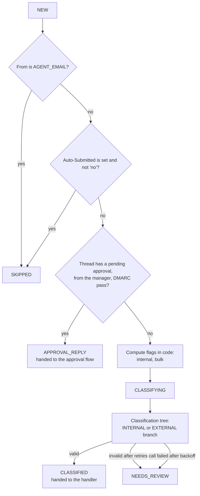
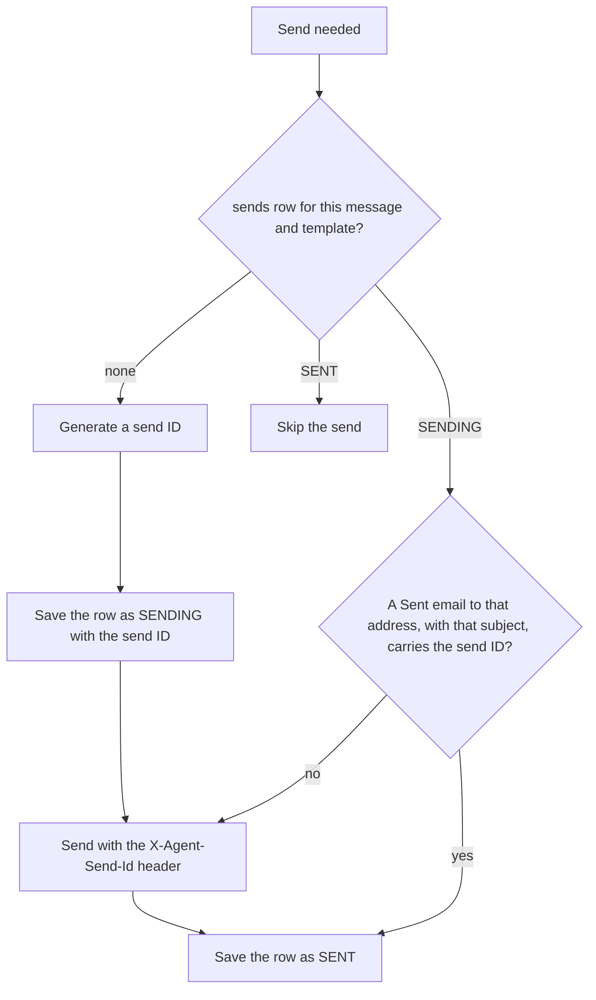

# Retrieving and classifying email

The agent polls Gmail for new inbox mail and runs each email through code checks. Only
then does it walk the [classification tree](classify-tree.md), which asks the LLM narrow
questions. Every email carries a saved state, so a crash or
restart resumes the email where it stopped. Every email state used by any flow is listed
in the [state catalog](state-audit.md#state-catalog).

## Decisions

| Topic | Decision |
| --- | --- |
| Trigger | Polling, every `POLL_SECONDS` from `.env`. The default is 5. |
| Normal poll | `history.list` returns `messageAdded` events since the saved `historyId`, filtered to `INBOX`. |
| Full sync | `messages.list` runs on first start, or when `history.list` returns 404 because the saved `historyId` expired. |
| First start | The full sync processes every unread inbox email. With `RUN_MODE=dev`, it processes every inbox email, read or not. |
| Own mail | Any message whose `From` is `AGENT_EMAIL` is skipped. |
| Approval replies | The manager's reply in a thread awaiting approval becomes `APPROVAL_REPLY`. It splits off before the label call and goes to the approval flow. |
| Header checks | The `Auto-Submitted` skip and the internal-sender check run in code before the LLM. The internal flag picks the tree's `INTERNAL` or `EXTERNAL` branch. |
| Bulk sender | Code flags an email as bulk when it has bulk headers (`List-Unsubscribe`, `List-Id`, `Precedence: bulk`) or its domain is on the configured bulk list. The flag goes to the label call as a hint. |
| Classification | A decision tree, in [classify-tree.md](classify-tree.md). One label call per branch, then the extraction calls that label needs: times for `MEETING_REQUEST`, invoice for `INFO_ONLY`, and urgent for every label except `SPAM` and `UNCLASSIFIED`. |
| Label call input | Headers, sender checks, the body cut at 1000 characters, every link, and attachment names and sizes. Details in [What the label call sees](#what-the-label-call-sees). |
| Times call input | A separate prompt. It gets the `Date` header and the email text only, cut at 1000 characters. Details in [What the times call sees](#what-the-times-call-sees). |
| Invoice call input | A separate prompt. It gets the `Subject`, attachment names and the email text cut at 1000 characters. Details in [What the invoice call sees](#what-the-invoice-call-sees). |
| Urgent call input | A separate prompt. It gets the `Date` and `Subject` headers, a priority-header hint, and the email text cut at 1000 characters. Details in [What the urgent call sees](#what-the-urgent-call-sees). |
| Triage result | The label and a short reason, plus the context the extraction calls returned: meeting date and time, invoice flag, urgent flag. |
| Order | One email at a time, in arrival order. |
| LLM call failures | Retry with backoff, then `NEEDS_REVIEW`. Polling continues. |
| Token failure mid-run | Log which token failed, then exit non-zero, like the [startup check](gmail-oauth.md#startup-check). |
| Crash recovery | Unfinished emails run before new mail, at most 3 attempts each. Then `NEEDS_REVIEW`. |
| Sends | Every send uses an idempotency key, so a rerun never sends the same email twice. |

## One poll

The new `historyId` is saved only after every new email has at least a `NEW` row. A crash
before that point refetches the same IDs, and the SQLite check drops them.

## One email

The internal flag is computed in code and stored with the email. It picks the branch of
the tree, so the model never decides who is internal.

## Classification tree

Code walks a *decision tree* and asks the LLM one narrow question at each node that needs
it. This is *conditional prompt chaining*: each call's answer decides whether another call
runs. An email costs at most three LLM calls: label, then times or invoice, then urgent.
The full tree is in [classify-tree.md](classify-tree.md).

| Branch | Label call can return | Extraction calls |
| --- | --- | --- |
| `EXTERNAL` | `MARKETING`, `SALES_OUTREACH`, `INFO_ONLY`, `SPAM`, `MEETING_REQUEST`, `TASK`, `UNCLASSIFIED` | Times for `MEETING_REQUEST`. Invoice for `INFO_ONLY`. Urgent for every label except `SPAM` and `UNCLASSIFIED`. |
| `INTERNAL` | `TASK`, `MEETING_REQUEST`, `UNCLASSIFIED` | Times for `MEETING_REQUEST`. Urgent for `TASK` and `MEETING_REQUEST`. |

`UNCLASSIFIED` is the escape hatch for an email that fits no label. Its handler does
nothing, and the engine still writes the audit entry. Urgent never branches the tree. It's
a parameter of the handler, which adds the `URGENT` label.

A `TASK` is a request the manager can approve or reject, such as "need approval for PTO
tomorrow". An action item that can't be approved, such as "need that velocity report", is
`UNCLASSIFIED`.

The bulk flag goes to the external label call as a hint, not proof, because bulk headers
are easy to forge.

## What the label call sees

Code picks the branch and builds this input. The model only chooses a label from that
branch's set.

| Part | Content |
| --- | --- |
| Headers | `From`, `To`, `Subject`, `Date` |
| `Reply-To` | Included when it differs from `From`. |
| DMARC | The `dmarc=` result from Gmail's `Authentication-Results` header. External branch only. |
| Bulk | A note that the sender is bulk, when code flagged it. |
| Body | The `text/plain` part. With only `text/html`, the HTML is converted to text, and each link shows as its text followed by its domain: `here (cal.com)`. Cut at 1000 characters. |
| Links | A separate context list of every link in the whole body, not just the first 1000 characters. Each entry pairs the link text with the link's domain, not the full URL, read from `<a href>` in code. The list reads the `text/html` part whenever the email has one, even when the body comes from `text/plain`. An email with no HTML part gives domains only. Redirects aren't followed. |
| Attachments | File names and sizes. Contents are never sent. |

## What the times call sees

The times call is its own prompt and runs only after the label call returns
`MEETING_REQUEST`. It sees none of the label call's context.

| Part | Content |
| --- | --- |
| `Date` | The email's `Date` header, so a date without a year gets the right one. |
| Body | The email text. In HTML, each link is replaced by its link text. A plain-text body keeps its full links. Cut at 1000 characters, after the links are replaced. |

| Email body | Times call sees |
| --- | --- |
| HTML: `Book a slot <a href="https://cal.com/x">here</a>, Thu 26 Nov works` | `Book a slot here, Thu 26 Nov works` |
| Plain text: `Pick a time at https://cal.com/x or Thu 26 Nov` | `Pick a time at https://cal.com/x or Thu 26 Nov` |

The call returns one explicit date and an optional clock time. Explicit means a written
day and month. Relative or vague words, such as "tomorrow", "Thursday", "afternoon" or
"next week", give no date. A missing year takes the `Date` header's year. When the email
names several dates, the call returns the first one.

| Output | Content |
| --- | --- |
| `meeting_date` | The date, or empty. |
| `date_quote` | The words in the email that carry the date. |
| `meeting_time` | The clock time, or empty. Only a written time counts, such as `14:00` or `2pm`. |
| `time_quote` | The words that carry the time. |

Examples, with the email sent Mon 23 Nov 2026:

| Email says | `meeting_date` | `meeting_time` |
| --- | --- | --- |
| "Can we meet Thu 26 Nov 2026?" | 2026-11-26 | empty |
| "Thu 26 Nov at 14:00" | 2026-11-26 | 14:00 |
| "26 Nov or 27 Nov, 2pm" | 2026-11-26 | 14:00 |
| "Thursday afternoon" | empty | empty |
| "Can we meet next week?" | empty | empty |

How the date and time become an event is in
[calendar-scheduling.md](calendar-scheduling.md).

## What the invoice call sees

The invoice call is its own prompt and runs only after the label call returns
`INFO_ONLY`, on the external branch. It answers one question: is this an invoice or a
receipt?

| Part | Content |
| --- | --- |
| `Subject` | As sent. "Invoice #4512" often appears only here. |
| Attachments | File names only, such as `invoice-4512.pdf`. |
| Body | Built like the times call's body, cut at 1000 characters. |

The call returns `is_invoice` and `evidence`, a quote copied from the subject, an
attachment name or the body. This is *generate-and-verify*: the model proposes a quote,
and code checks it appears in the email. `is_invoice` can't be true without a quote.

| Email | `is_invoice` | `evidence` |
| --- | --- | --- |
| "Invoice #4512 for October" | true | `Invoice #4512` |
| Receipt with `receipt-981.pdf` attached | true | `receipt-981.pdf` |
| "FYI, our office is closed Friday" | false | none |

## What the urgent call sees

The urgent call is its own prompt. It runs after every label except `SPAM` and
`UNCLASSIFIED`, after the times or invoice call when the label has one.
Urgent means a deadline or an escalation, and both show up in the subject and body.

| Part | Content |
| --- | --- |
| `Date` | The email's `Date` header, so "by Friday" can be judged against when it was sent. |
| `Subject` | As sent. "URGENT:" or "ASAP" often appears only here. |
| Priority hint | A note when `Importance: high`, `X-Priority: 1` or `Priority: urgent` is set. A hint, not proof, since any sender can set these headers. |
| Body | Built like the times call's body: HTML links replaced by their text, plain-text links kept, cut at 1000 characters. |

`From`, DMARC, the internal flag, attachments and the links list are left out. The
internal flag already picked the branch, and urgency comes from what the email says.

The call returns `urgent` and `evidence`, a quote of the deadline or escalation copied
from the email. Code checks the quote appears in the email, the same generate-and-verify
check as the invoice call. `urgent` can't be true without a quote.

| Email | `urgent` | `evidence` |
| --- | --- | --- |
| Colleague: "PTO approval needed today", sent Monday | true | `needed today` |
| Customer: "when you get a chance" | false | none |
| `Importance: high`, no deadline in the body | false | none |

Email text is untrusted. It may contain *prompt injection*, text written to steer the
model. The model has no tools and can only answer the question its call asks, so injected
text can at worst produce a wrong label or wrong context.

## Triage result

| Field | Holds | Set by |
| --- | --- | --- |
| `label` | One primary label from [REQUIREMENTS.md](REQUIREMENTS.md#labels), or `UNCLASSIFIED`. | Label call |
| `reason` | A short explanation, written to the audit log. | Label call |
| `meeting_date`, `meeting_time` | The explicit date and optional time, each with its quote. Empty unless the label is `MEETING_REQUEST`. | Times call |
| `is_invoice`, `invoice_evidence` | Whether an `INFO_ONLY` email is an invoice or receipt, and the quote that shows it. Unset for every other label. | Invoice call |
| `urgent` | Whether the email carries a deadline or an escalation. Unset for `SPAM` and `UNCLASSIFIED`. | Urgent call |
| `evidence` | The deadline or escalation quoted from the email. Empty unless `urgent` is true. | Urgent call |

Each extraction call has an output validator. The times call checks each quote appears in
the email, and that a time never comes without a date. The invoice and urgent calls check
their quote appears in the email, and that the flag is false when the quote is empty. A
failed check sends the error back to the model, which answers again. When the retries run
out, the email goes to `NEEDS_REVIEW`.

## Retries and crash recovery

| Failure | Handling |
| --- | --- |
| Invalid answer from any tree call | Pydantic-AI re-asks the model. After the retries run out, `NEEDS_REVIEW`. |
| LLM call fails (connection error, timeout, `429`, `5xx` including wrapper `502` or `504`) | Retry with backoff. Then `NEEDS_REVIEW`. |
| LLM call rejected (any other `4xx`, such as `401`) | `NEEDS_REVIEW` with no retry. |
| Google token refresh fails | Log which token failed, then exit non-zero. |
| Gmail or Calendar API error, such as `429` or `5xx` | Not covered in the demo. |
| Agent crashes mid-email | On restart the email resumes from its saved state, before any new mail. |

Each email row keeps an attempt counter. It goes up each time processing of the email
starts, before any step runs. An email that crashes the agent every time is a *poison
message*, and the counter stops it from looping. After 3 attempts the email goes to
`NEEDS_REVIEW` and isn't retried. The reason is read from that email's log entries.

## Sending without duplicates

Labels, archiving and moving to Spam are safe to repeat. Sending isn't. Every send uses an
*idempotency key*, a unique ID that lets a rerun tell a finished send from an unfinished
one.

Each send has its own row in the `sends` table, keyed by the message ID being processed
plus the template. The send states are in [state-audit.md](state-audit.md#send-states).

The key travels in an `X-Agent-Send-Id` header. Gmail replaces any `Message-ID` the agent
sets, so that header can't carry it. Gmail keeps custom headers, but can't search them.
A rerun searches Sent by recipient and subject, then reads the header of each match.

In dev the agent sends only to `MANAGER_EMAIL`, through the same guard. Any other send
prints `DEV would send <template> to <address>` and writes no `sends` row.
