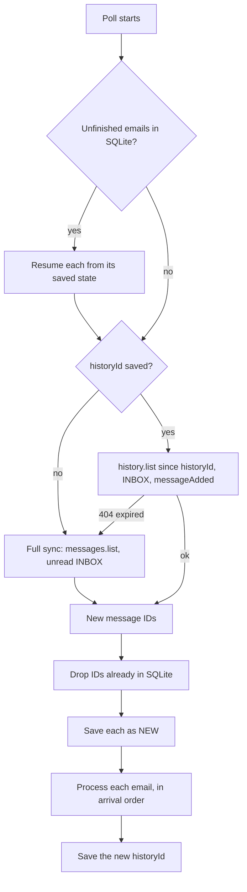
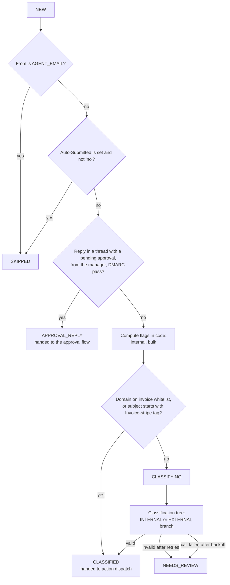
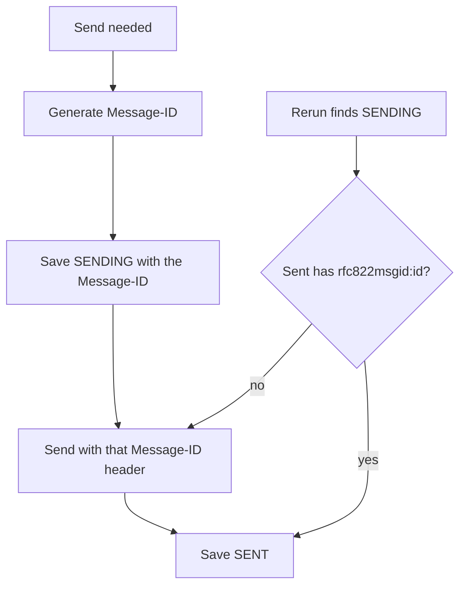

# Retrieving and classifying email

The agent polls Gmail for new inbox mail and runs each email through code checks. Only
then does it walk the [classification tree](classify-tree.md), which asks the LLM narrow
questions. Every email carries a saved state, so a crash or
restart resumes the email where it stopped. This doc also holds the catalog of every
email state used by any flow.

## Decisions

| Topic | Decision |
| --- | --- |
| Trigger | Polling. |
| Normal poll | `history.list` returns `messageAdded` events since the saved `historyId`, filtered to `INBOX`. |
| Full sync | `messages.list` runs on first start, or when `history.list` returns 404 because the saved `historyId` expired. |
| First start | The full sync processes every unread inbox email. |
| Own mail | Any message whose `From` is `AGENT_EMAIL` is skipped. |
| Approval replies | They split off before the LLM and go to the approval flow. |
| Header checks | The `Auto-Submitted` skip and the internal-sender check run in code before the LLM. The internal flag picks the tree's `INTERNAL` or `EXTERNAL` branch. |
| Finance check | Code labels an email `INFO_ONLY` for the `Finance` label when its domain is on the invoice whitelist or its subject starts with `[Invoice-stripe]`. Either one is enough, and the LLM is never called. This is the only check that separates invoices from spam. |
| Bulk sender | Code flags an email as bulk when it has bulk headers (`List-Unsubscribe`, `List-Id`, `Precedence: bulk`) or its domain is on the configured bulk list. The flag goes to the label call as context. |
| Classification | A decision tree, in [classify-tree.md](classify-tree.md). One label call per branch, then a times call for `MEETING_REQUEST` or an urgent call for `TASK`. |
| Label call input | Headers, sender checks, the body cut at 1000 characters, every link, and attachment names and sizes. Details in [What the label call sees](#what-the-label-call-sees). |
| Times call input | A separate prompt. It gets the `Date` header and the email text only, cut at 1000 characters. Details in [What the times call sees](#what-the-times-call-sees). |
| Urgent call input | A separate prompt. It gets the `Date` and `Subject` headers, a priority-header hint, and the email text cut at 1000 characters. Details in [What the urgent call sees](#what-the-urgent-call-sees). |
| Triage result | The label and a short reason, plus the context the follow-up call extracted: proposed times or the urgent flag. |
| Order | One email at a time, in arrival order. |
| LLM call failures | Retry with backoff, then `NEEDS_REVIEW`. Polling continues. |
| Token failure mid-run | Log which token failed, then exit non-zero, like the [startup check](gmail-oauth.md#startup-check). |
| Crash recovery | Unfinished emails run before new mail, at most 3 attempts each. Then `NEEDS_REVIEW`. |
| Sends | Every send uses an idempotency key, so a rerun never sends the same email twice. |

## One poll

The new `historyId` is saved only after every new email has at least a `NEW` row. A crash
before that point refetches the same IDs, and the SQLite check drops them.

## One email

The internal flag is computed in code and stored with the email. It picks the branch of
the tree, so the model never decides who is internal.

A finance match goes straight to `CLASSIFIED`. Code saves a `Triage` with the label
`INFO_ONLY`, no proposed times, and a reason naming the rule that matched. The check runs
before the tree, so a matched receipt never reaches an LLM call.

| Finance rule | Matches |
| --- | --- |
| Invoice whitelist | The sender's domain is on the configured list of domains expected to send invoices. |
| Subject prefix | The subject starts with `[Invoice-stripe]`. This is a demo tell, and anyone can forge it. |

## Classification tree

Code walks a *decision tree* and asks the LLM one narrow question at each node that needs
it. This is *conditional prompt chaining*: each call's answer decides whether another call
runs. An email costs at most two LLM calls. The full tree is in
[classify-tree.md](classify-tree.md).

| Branch | Label call can return | Follow-up call |
| --- | --- | --- |
| `EXTERNAL` | `MARKETING`, `SALES_OUTREACH`, `INFO_ONLY`, `SPAM`, `MEETING_REQUEST`, `TASK`, `UNCLASSIFIED` | Times for `MEETING_REQUEST`, urgent for `TASK` |
| `INTERNAL` | `TASK`, `MEETING_REQUEST`, `UNCLASSIFIED` | Times for `MEETING_REQUEST`, urgent for `TASK` |

`UNCLASSIFIED` is the escape hatch for an email that fits no label. Its action only writes
a log line. Urgent never branches the tree; it's context passed to the `TASK` action.

The bulk flag goes to the external label call as a hint, not proof, because bulk headers
are easy to forge.

## What the label call sees

Code picks the branch and builds this input. The model only chooses a label from that
branch's set.

| Part | Content |
| --- | --- |
| Headers | `From`, `To`, `Subject`, `Date` |
| `Reply-To` | Included when it differs from `From`. |
| DMARC | The `dmarc=` result from Gmail's `Authentication-Results` header. External branch only. |
| Bulk | A note that the sender is bulk, when code flagged it. |
| Body | The `text/plain` part. With only `text/html`, the HTML is converted to text. Cut at 1000 characters. |
| Links | A separate context list of every link in the whole body, not just the first 1000 characters. Each entry pairs the link text with the link's domain, not the full URL, read from `<a href>` in code. A plain-text body gives the domain only. Redirects aren't followed. |
| Attachments | File names and sizes. Contents are never sent. |

## What the times call sees

The times call is its own prompt and runs only after the label call returns
`MEETING_REQUEST`. It sees none of the label call's context.

| Part | Content |
| --- | --- |
| `Date` | The email's `Date` header, so relative times like "tomorrow at 2pm" resolve to a real date. |
| Body | The email text. In HTML, each link is replaced by its link text. A plain-text body keeps its full links. Cut at 1000 characters, after the links are replaced. |

| Email body | Times call sees |
| --- | --- |
| HTML: `Book a slot <a href="https://cal.com/x">here</a>, Thu 2pm works` | `Book a slot here, Thu 2pm works` |
| Plain text: `Pick a time at https://cal.com/x or Thu 2pm` | `Pick a time at https://cal.com/x or Thu 2pm` |

## What the urgent call sees

The urgent call is its own prompt and runs only after the label call returns `TASK`.
Urgent means a deadline or an escalation, and both show up in the subject and body.

| Part | Content |
| --- | --- |
| `Date` | The email's `Date` header, so "by Friday" can be judged against when it was sent. |
| `Subject` | As sent. "URGENT:" or "ASAP" often appears only here. |
| Priority hint | A note when `Importance: high`, `X-Priority: 1` or `Priority: urgent` is set. A hint, not proof, since any sender can set these headers. |
| Body | Built like the times call's body: HTML links replaced by their text, plain-text links kept, cut at 1000 characters. |

`From`, DMARC, the internal flag, attachments and the links list are left out. The
internal flag already picked the branch, and urgency comes from what the email says.

The call returns `urgent` and `evidence`, a quote of the deadline or escalation copied
from the email. This is *generate-and-verify*: the model proposes a quote, and code checks
it appears in the email. `urgent` can't be true without a quote.

| Email | `urgent` | `evidence` |
| --- | --- | --- |
| CEO: "contract due today", sent Monday | true | `due today` |
| Customer: "when you get a chance" | false | none |
| `Importance: high`, no deadline in the body | false | none |

Email text is untrusted. It may contain *prompt injection*, text written to steer the
model. The model has no tools and can only answer the question its call asks, so injected
text can at worst produce a wrong label or wrong context.

## Triage result

| Field | Holds | Set by |
| --- | --- | --- |
| `label` | One primary label from [REQUIREMENTS.md](REQUIREMENTS.md#labels), or `UNCLASSIFIED`. | Label call |
| `reason` | A short explanation, written to the audit log. | Label call |
| `proposed_times` | Time windows, each a `quote` from the email plus `start` and `end`. Details in [calendar-scheduling.md](calendar-scheduling.md#times-as-windows). Empty unless the label is `MEETING_REQUEST`. | Times call |
| `urgent` | Whether the email carries a deadline or an escalation. Unset unless the label is `TASK`. | Urgent call |
| `evidence` | The deadline or escalation quoted from the email. Empty unless `urgent` is true. | Urgent call |

The times call has an output validator that checks every window's `quote` appears in the
email. The urgent call's validator checks that `evidence` appears in the email, and that
`urgent` is false when `evidence` is empty. A failed check
sends the error back to the model, which answers again. When the retries run out, the
email goes to `NEEDS_REVIEW`.

## Retries and crash recovery

| Failure | Handling |
| --- | --- |
| Invalid answer from any tree call | Pydantic-AI re-asks the model. After the retries run out, `NEEDS_REVIEW`. |
| LLM call fails (API error, wrapper `502` or `504`) | Retry with backoff. Then `NEEDS_REVIEW`. |
| Google token refresh fails | Log which token failed, then exit non-zero. |
| Agent crashes mid-email | On restart the email resumes from its saved state, before any new mail. |

Each email row keeps an attempt counter. It goes up each time processing of the email
starts, before any step runs. An email that crashes the agent every time is a *poison
message*, and the counter stops it from looping. After 3 attempts the email goes to
`NEEDS_REVIEW` and isn't retried. The reason is read from that email's log entries.

## Sending without duplicates

Labels, archiving and moving to Spam are safe to repeat. Sending isn't. Every send uses an
*idempotency key*, a unique ID that lets a rerun tell a finished send from an unfinished
one.

## State catalog

Every state an email can be in, across all flows. A state is saved right after the step
that reaches it succeeds, and a rerun starts from the saved state.

| State | Owner | Meaning |
| --- | --- | --- |
| `NEW` | Retrieval | Fetched and recorded. No checks have run. |
| `SKIPPED` | Retrieval | The agent's own mail, or an automatic reply. No label and no action. Final. |
| `APPROVAL_REPLY` | Retrieval | The manager's reply to a pending approval. Handed to the approval flow, never classified. |
| `CLASSIFYING` | Classification | The classification tree has started. A rerun from here walks the tree again from the label call. |
| `CLASSIFIED` | Classification | A valid `Triage` is saved. Handed to action dispatch. |
| `ARCHIVED` | Marketing | The `MARKETING` label is on and `INBOX` is off. The audit entry isn't written yet. |
| `SENDING` | Any flow that sends | The `Message-ID` is saved and the send may or may not have happened. A rerun checks Sent first. |
| `SENT` | Any flow that sends | The email went out. |
| `AWAITING_APPROVAL` | Approval | The summary went to the manager. The action waits for an APPROVE or REJECT reply. |
| `DONE` | Action dispatch | Every step for the email finished. Final. |
| `NEEDS_REVIEW` | Any flow | The email couldn't be processed, after the retries or 3 attempts ran out. Final. |

The action dispatch, approval and calendar flows add their own states to this table when
they're designed.
