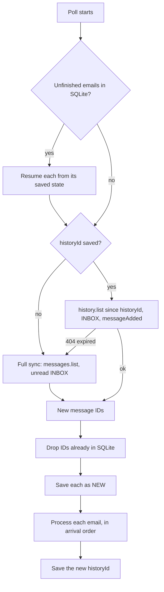
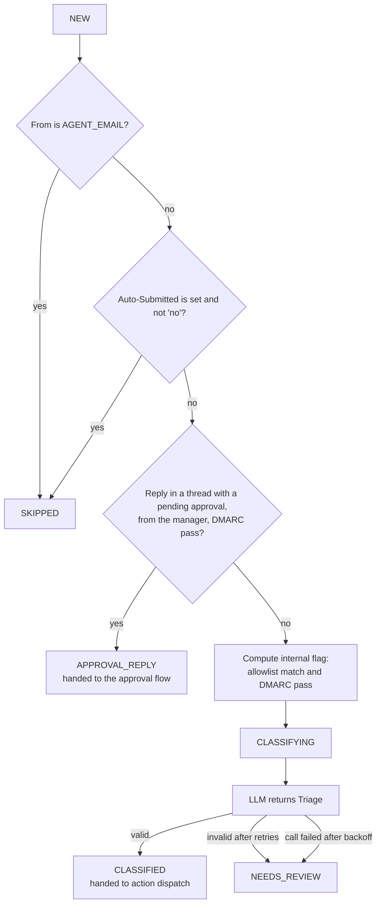
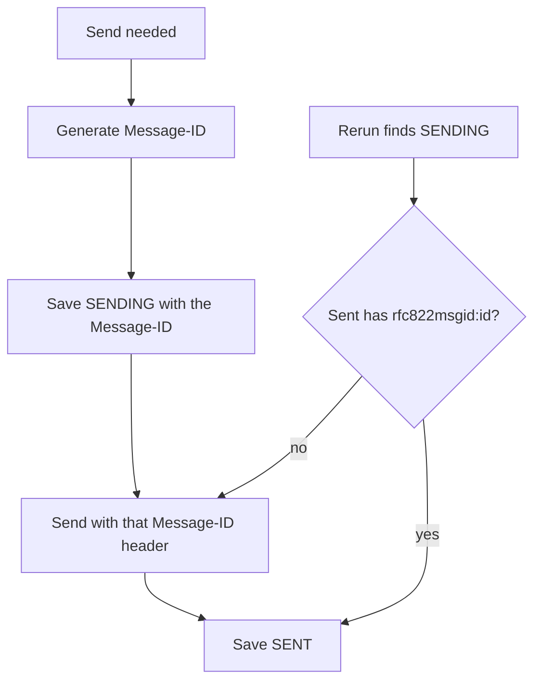

# Retrieving and classifying email

The agent polls Gmail for new inbox mail and runs each email through code checks. Only
then does it ask the LLM for a label. Every email carries a saved state, so a crash or
restart resumes the email where it stopped. This doc also holds the catalog of every
email state used by any flow.

## Decisions

| Topic | Decision |
| --- | --- |
| Trigger | Polling. |
| Normal poll | `history.list` returns `messageAdded` events since the saved `historyId`, filtered to `INBOX`. |
| Full sync | `messages.list` runs on first start, or when `history.list` returns 404 because the saved `historyId` expired. |
| First start | The full sync processes every unread inbox email. |
| Own mail | Any message whose `From` is `AGENT_EMAIL` is skipped. |
| Approval replies | They split off before the LLM and go to the approval flow. |
| Header checks | The `Auto-Submitted` skip and the internal-sender check run in code before the LLM. |
| LLM input | `From`, `To`, `Subject`, `Date`, and the plain-text body cut at a fixed character cap. HTML is converted to text. Attachments appear by file name only. |
| Triage result | Primary label, urgent flag, proposed times quoted from the email, and a short reason. |
| Order | One email at a time, in arrival order. |
| LLM call failures | Retry with backoff, then `NEEDS_REVIEW`. Polling continues. |
| Token failure mid-run | Log which token failed, then exit non-zero, like the [startup check](gmail-oauth.md#startup-check). |
| Crash recovery | Unfinished emails run before new mail, at most 3 attempts each. Then `NEEDS_REVIEW`. |
| Sends | Every send uses an idempotency key, so a rerun never sends the same email twice. |

## One poll

The new `historyId` is saved only after every new email has at least a `NEW` row. A crash
before that point refetches the same IDs, and the SQLite check drops them.

## One email

The internal flag is computed in code and stored with the email. Action dispatch combines
it with the label, so the model never decides who is internal.

## What the LLM sees

| Part | Content |
| --- | --- |
| Headers | `From`, `To`, `Subject`, `Date` |
| Body | The `text/plain` part. With only `text/html`, the HTML is converted to text. |
| Cap | The body is cut at a fixed character limit. |
| Attachments | File names only. Contents are never sent. |

Email text is untrusted. It may contain *prompt injection*, text written to steer the
model. The model has no tools and can only return a `Triage`, so injected text can at
worst produce a wrong label.

## Triage result

| Field | Holds |
| --- | --- |
| `label` | One primary label from [REQUIREMENTS.md](REQUIREMENTS.md#labels). |
| `urgent` | Whether the email carries a deadline or an escalation. Always false for `SPAM`. |
| `proposed_times` | Meeting times quoted from the email text. Empty when there are none. |
| `reason` | A short explanation, written to the audit log. |

An output validator checks that every proposed time appears in the email. A failed check
sends the error back to the model, which answers again. When the retries run out, the
email goes to `NEEDS_REVIEW`.

## Retries and crash recovery

| Failure | Handling |
| --- | --- |
| Invalid `Triage` | Pydantic-AI re-asks the model. After the retries run out, `NEEDS_REVIEW`. |
| LLM call fails (API error, wrapper `502` or `504`) | Retry with backoff. Then `NEEDS_REVIEW`. |
| Google token refresh fails | Log which token failed, then exit non-zero. |
| Agent crashes mid-email | On restart the email resumes from its saved state, before any new mail. |

Each email row keeps an attempt counter. It goes up each time processing of the email
starts, before any step runs. An email that crashes the agent every time is a *poison
message*, and the counter stops it from looping. After 3 attempts the email goes to
`NEEDS_REVIEW` and isn't retried. The reason is read from that email's log entries.

## Sending without duplicates

Labels, archiving and moving to Spam are safe to repeat. Sending isn't. Every send uses an
*idempotency key*, a unique ID that lets a rerun tell a finished send from an unfinished
one.

## State catalog

Every state an email can be in, across all flows. A state is saved right after the step
that reaches it succeeds, and a rerun starts from the saved state.

| State | Owner | Meaning |
| --- | --- | --- |
| `NEW` | Retrieval | Fetched and recorded. No checks have run. |
| `SKIPPED` | Retrieval | The agent's own mail, or an automatic reply. No label and no action. Final. |
| `APPROVAL_REPLY` | Retrieval | The manager's reply to a pending approval. Handed to the approval flow, never classified. |
| `CLASSIFYING` | Classification | The LLM call has started. A rerun from here calls the LLM again. |
| `CLASSIFIED` | Classification | A valid `Triage` is saved. Handed to action dispatch. |
| `SENDING` | Any flow that sends | The `Message-ID` is saved and the send may or may not have happened. A rerun checks Sent first. |
| `SENT` | Any flow that sends | The email went out. |
| `AWAITING_APPROVAL` | Approval | The summary went to the manager. The action waits for an APPROVE or REJECT reply. |
| `DONE` | Action dispatch | Every step for the email finished. Final. |
| `NEEDS_REVIEW` | Any flow | The email couldn't be processed, after the retries or 3 attempts ran out. Final. |

The action dispatch, approval and calendar flows add their own states to this table when
they're designed.
