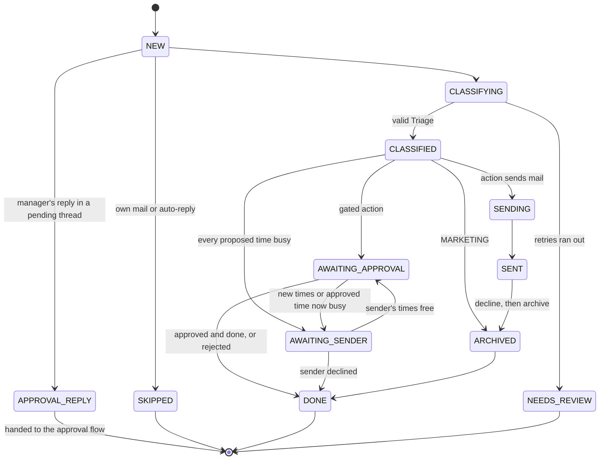

# State and audit log

What the agent saves about each email, and the audit trail it leaves.

## Decisions

| Topic | Decision |
| --- | --- |
| Tables | One SQLite table per concern: `emails`, `approvals`, `audit`, `meta`. |
| `emails` | One row per message ID, with its Gmail `thread_id`, state and attempt count. The `thread_id` joins a reply to its pending approval. |
| `approvals` | One row per thread ID, with its state and proposed times. |
| `meta` | The saved Gmail `historyId`. |
| Audit store | Each entry is written to the `audit` table and printed to stdout as a JSON line. The table is the durable record, and stdout shows the live run. |
| Audit timing | One entry per processed email, written when it reaches a final state: `DONE`, `SKIPPED` or `NEEDS_REVIEW`. |
| Manager replies | An `APPROVAL_REPLY` email gets no entry of its own. The approval's result shows in the original email's outcome. |
| Audit fields | Label, action, outcome. |
| On behalf of | Out of scope. The agent only acts as `AGENT_EMAIL`, so entries have no "acted for" or "approved by" field. |

## State catalog

Every state an email can be in, across all flows. A state is saved right after the step
that reaches it succeeds, and a rerun starts from the saved state.

| State | Owner | Meaning |
| --- | --- | --- |
| `NEW` | Retrieval | Fetched and recorded. No checks have run. |
| `SKIPPED` | Retrieval | The agent's own mail, or an automatic reply. No label and no action. Final. |
| `APPROVAL_REPLY` | Retrieval | The manager's reply to a pending approval. Handed to the approval flow, never classified. |
| `CLASSIFYING` | Classification | The classification tree has started. A rerun from here walks the tree again from the label call. |
| `CLASSIFIED` | Classification | A valid `Triage` is saved. Handed to action dispatch. |
| `ARCHIVED` | Marketing | The `MARKETING` label is on and `INBOX` is off. The audit entry isn't written yet. |
| `SENDING` | Any flow that sends | The `Message-ID` is saved and the send may or may not have happened. A rerun checks Sent first. |
| `SENT` | Any flow that sends | The email went out. |
| `AWAITING_APPROVAL` | Approval | The summary went to the manager. The action waits for an APPROVE or REJECT reply. |
| `AWAITING_SENDER` | Approval | The agent sent the sender new times, or asked them for times. Waiting for the sender's reply. |
| `DONE` | Action dispatch | Every step for the email finished. Final. |
| `NEEDS_REVIEW` | Any flow | The email couldn't be processed, after the retries or 3 attempts ran out. Final. |

The action dispatch, approval and calendar flows add their own states to this table when
they're designed.

The audit entry is written on the way into `DONE`, `SKIPPED` or `NEEDS_REVIEW`. Any
state can move to `NEEDS_REVIEW` once its retries run out; only the classification edge is
drawn.
