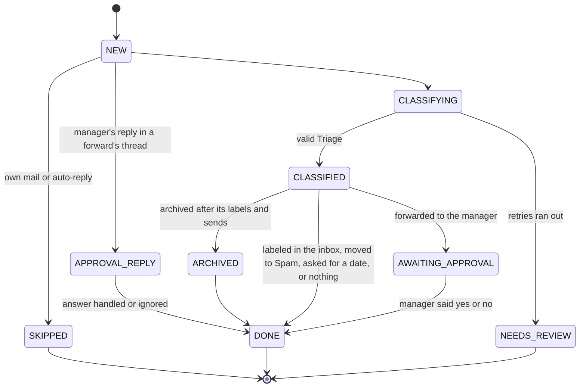

# State and audit log

What the agent saves about each email, and the audit trail it leaves.

## Decisions

| Topic | Decision |
| --- | --- |
| Tables | One SQLite table per concern: `emails`, `approvals`, `sends`, `audit`, `meta`. |
| `emails` | One row per message ID, with its Gmail `thread_id`, state and attempt count. |
| `approvals` | One row per forward, keyed by the forward's thread ID. It points back to the original email. Details in [Tables](#tables). |
| `sends` | One row per outgoing email, keyed by the message ID being processed and the template. It holds the generated send ID and the send state. Details in [Send states](#send-states). |
| `meta` | The saved Gmail `historyId`. |
| Audit store | Each entry is written to the `audit` table and printed to stdout as a JSON line. The table is the durable record, and stdout shows the live run. |
| Who writes entries | The engine, after every handler and every approval reply. Handlers never write entries. |
| Audit timing | An entry when an email enters `AWAITING_APPROVAL`, and one when it reaches a final state: `DONE`, `SKIPPED` or `NEEDS_REVIEW`. An email still waiting when the run ends has an entry. |
| Replies | An `APPROVAL_REPLY` gets its own entry, with the answer it carried. A matched reply also closes the original email with its own `DONE` entry. |
| Audit fields | Label, urgent, action, outcome, detail. Values in [Audit entry](#audit-entry). |
| On behalf of | Out of scope. The agent only acts as `AGENT_EMAIL`, so entries have no "acted for" or "approved by" field. |

## State catalog

Every state an email can be in, across all flows. A state is saved right after the step
that reaches it succeeds, and a rerun starts from the saved state.

| State | Owner | Meaning |
| --- | --- | --- |
| `NEW` | Retrieval | Fetched and recorded. No checks have run. |
| `SKIPPED` | Retrieval | The agent's own mail, or an automatic reply. No label and no action. Final. |
| `APPROVAL_REPLY` | Retrieval | The manager's reply in a forward's thread. Handed to the approval flow, never classified. |
| `CLASSIFYING` | Classification | The classification tree has started. A rerun from here walks the tree again from the label call. |
| `CLASSIFIED` | Classification | A valid `Triage` is saved. Handed to the handler. |
| `ARCHIVED` | Handler | The email's labels are on and `INBOX` is off. Reached by `MARKETING`, `SALES_OUTREACH` and invoices. The audit entry isn't written yet. |
| `AWAITING_APPROVAL` | Approval | The forward went to the manager. Waiting for a yes or no. |
| `DONE` | Handler or approval | Every step for the email finished. Final. |
| `NEEDS_REVIEW` | Any flow | The email couldn't be processed, after the retries or 3 attempts ran out. Final. |

An audit entry is written on the way into `AWAITING_APPROVAL`, `DONE`, `SKIPPED` or
`NEEDS_REVIEW`. Any state can move to `NEEDS_REVIEW` once its retries run out; only the
classification edge is drawn.

## Send states

Sends aren't email states. Each outgoing email gets its own row in `sends`, so a rerun
knows which one went out.

| State | Meaning |
| --- | --- |
| `SENDING` | The send ID is saved and the send may or may not have happened. A rerun checks Sent first. |
| `SENT` | The email went out. |

The row key is the message ID being processed plus the template name.

| Message being processed | Template | Sent to |
| --- | --- | --- |
| Jane's "Need approval for PTO tomorrow" | Approval: task | Manager |
| The manager's "Yes, enjoy" | Task approved | Jane |

The email's own state moves on only after every send in its step is `SENT`.

## Tables

`emails`: one row per Gmail message.

| Column | Holds |
| --- | --- |
| `message_id` | Gmail message ID. Primary key. |
| `thread_id` | Gmail `threadId`. Joins a manager reply to its approval. |
| `internal_date` | Gmail's `internalDate`. Sets the arrival order. |
| `state` | A state from the [state catalog](#state-catalog). |
| `attempts` | How many times processing has started. Capped at 3. |
| `internal` | Whether the sender passed the internal check. |
| `triage` | The `Triage` result as JSON. Empty until `CLASSIFIED`. |
| `updated_at` | When the state last changed. |

`approvals`: one row per forward.

| Column | Holds |
| --- | --- |
| `forward_thread_id` | The forward's Gmail `threadId`, F. Primary key. Also the event ID. |
| `message_id` | The original email the approval belongs to. Its row in `emails` carries the waiting state. |
| `original_thread_id` | The original email's thread, T. Replies to the sender go there. |
| `kind` | `MEETING` or `TASK`. |
| `state` | `AWAITING_APPROVAL` or `DONE`. |
| `sender_email`, `sender_name` | The original sender. `sender_email` is the `Reply-To`, else the `From`: the answer goes there. |
| `original_subject` | The original subject, without `Re:`. |
| `meeting_start`, `meeting_end` | The event's start and end. Meetings only. |
| `latest_sender_rfc_id` | The sender's `Message-ID`, for `In-Reply-To` and `References` on the reply to the sender. |
| `updated_at` | When the state last changed. |

`sends`: one row per outgoing email.

| Column | Holds |
| --- | --- |
| `message_id` | The Gmail message being processed. Primary key, with `template`. |
| `template` | The template name. |
| `send_id` | The ID generated for the send, sent as the `X-Agent-Send-Id` header. |
| `state` | `SENDING` or `SENT`. |

`meta`: key and value pairs. The only key is `history_id`.

## Audit entry

`audit` has one row per entry, also printed to stdout as one JSON line.

| Column | Holds |
| --- | --- |
| `id` | Auto-increment. |
| `at` | When the entry was written. |
| `message_id`, `thread_id` | The email the entry is about. |
| `label` | The primary label, or empty when none was set. |
| `urgent` | The urgent flag, or empty when the urgent call didn't run. |
| `action` | What the agent did in this step. Values below. |
| `outcome` | The state reached: `AWAITING_APPROVAL`, `DONE`, `SKIPPED` or `NEEDS_REVIEW`. |
| `detail` | A short reason, such as `auto-reply`, `retries ran out` or `no decision word`. |

| `action` | Step |
| --- | --- |
| `none` | Skipped, or failed before any action. |
| `archive` | `MARKETING`, or `SALES_OUTREACH` with declines off: labeled and archived, no send. |
| `decline_and_archive` | `SALES_OUTREACH` decline sent, then archived. |
| `label_only` | `INFO_ONLY` that isn't an invoice: labeled, kept in the inbox. |
| `finance_and_archive` | `INFO_ONLY` invoice or receipt: `Finance` added, archived. |
| `move_to_spam` | Moved to Spam. |
| `none_unclassified` | `UNCLASSIFIED`. The handler did nothing. |
| `forward_for_approval` | The forward went to the manager. |
| `ask_for_date` | A `MEETING_REQUEST` without a date. The sender was asked for one. |
| `create_event` | The manager said yes to a meeting. The event was created. |
| `send_meeting_decline` | The manager said no to a meeting. The sender got the decline. |
| `send_task_approved` | The manager said yes to a task. The sender was told. |
| `send_task_rejected` | The manager said no to a task. The sender was told. |
| `ignore_reply` | A manager reply with no decision word. The approval keeps waiting. |
